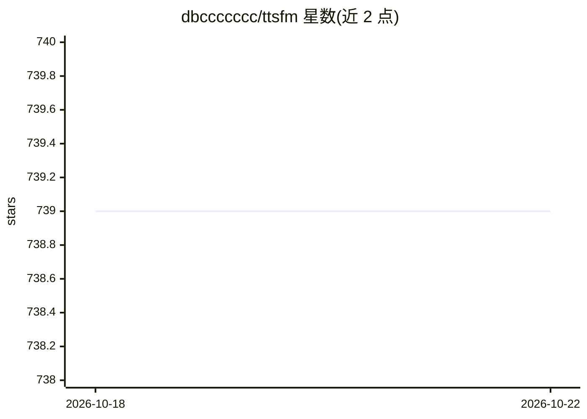

# dbccccccc/ttsfm

⭐ 740 · Python · MIT · 推送 2026-06-30 · [GitHub](https://github.com/dbccccccc/ttsfm) · 个人维护 · 中文 README

**逆向代理 openai.fm 的 OpenAI 兼容 TTS API 服务**

基于 openai.fm 后端构建的免费文本转语音服务，提供 OpenAI 兼容的 REST 端点（/v1/audio/speech）、Python SDK（同步/异步）、CLI 与 Web playground。支持 11 种 OpenAI 兼容语音、6 种音频格式（格式转换与变速依赖 ffmpeg，仅完整镜像支持）、0.25-4.0 倍速、长文本自动切分合并与 WebSocket 流式生成。提供 full 与 slim 两种 Docker 镜像。README 声明仅限教育与研究用途，逆向实现，不得商用或用于生产环境。

## 筛选速览

| 维度 | 判定 | 备注 |
|---|---|---|
| AI 角色 | `ai-ecosystem` | LLM/agent 周边工具 |
| 许可风险 | `permissive` | MIT |
| 部署形态 | `self-host` | docker 或自建部署 |
| 模型依赖 | — | README 未给出锁定关系 |
| 硬件要求 | — | 无带数字的原话,不猜 |
| 安装摩擦 | `low` | 无编译、无系统依赖或容器化 |
| 成熟度 | — | 结构信号不足 |

## 能力要点

- OpenAI TTS API 的 drop-in replacement 兼容端点
- 11 种语音、6 种音频格式、0.25-4.0 倍速调节（依赖 ffmpeg）
- 长文本自动切分与音频合并、WebSocket 流式生成
- 提供 Python SDK、CLI、Web playground 与双 Docker 镜像（full/slim）

## 适用场景

- 自部署一个 OpenAI 兼容的 TTS 端点供现有应用调用
- 通过 Web playground 快速试听不同语音与格式
- 在 Python 或 CLI 中将长文本批量转为语音

## 场景标签

`语音合成` · 领域:内容生成

## 证据(README 行号)

> L14: TTSFM is a free, OpenAI-compatible text-to-speech API service that provides a complete solution for converting text
> L76: The container exposes the web playground at `http://localhost:8000` and an OpenAI-compatible endpoint at `/v1/audio
> L36: > **⚠️ Disclaimer**: This project is intended for **educational and research purposes only**. It is a reverse-engin

## 星数曲线

2026-10-18 739 → 2026-10-22 739（+0）

---
*卡片 v1 · prompt 1.4 · 生成 2026-10-21 · 置信度 high · 依据 README sha `87d7150a6bf7` · [字段定义](../../DATASET.md)*
