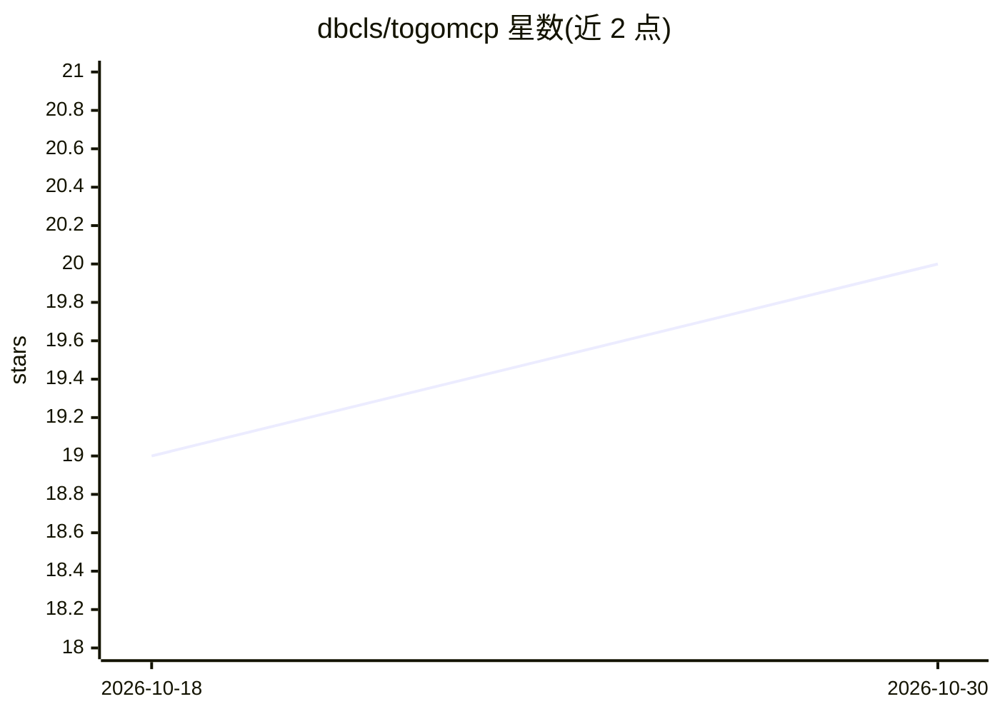

# dbcls/togomcp

⭐ 20 · Python · MIT · 推送 2026-10-27 · [GitHub](https://github.com/dbcls/togomcp) · [官网](http://togomcp.rdfportal.org/) · 组织维护

**让 AI 助手用自然语言查询生命科学知识图谱的 MCP 服务器**

由 DBCLS 维护的 MCP（Model Context Protocol）服务器，向 Claude 等 AI 助手开放生物与生物医学 RDF 数据库的 SPARQL 查询能力（主要经 RDF Portal），并接入 NCBI E-utilities、UniProt、ChEMBL、Reactome 等约 15 类 REST API，覆盖蛋白质、基因、化学、通路、疾病、文献等 14 个类别的资源。提供托管远程服务（免安装）与本地部署（Python>=3.11 + uv，或 Docker/compose）两种方式。可选工具级 JSONL 调用日志；KEGG 工具因许可限制默认关闭，仅本地 stdio 模式且显式开启后可用。

## 筛选速览

| 维度 | 判定 | 备注 |
|---|---|---|
| AI 角色 | `ai-ecosystem` | LLM/agent 周边工具 |
| 许可风险 | `permissive` | MIT |
| 部署形态 | `self-host` | docker 或自建部署 |
| 模型依赖 | locked-api |  |
| 硬件要求 | — | 无带数字的原话,不猜 |
| 安装摩擦 | `low` | 无编译、无系统依赖或容器化 |
| 成熟度 | — | 结构信号不足 |

## 能力要点

- 通过 SPARQL/REST 接入数十个生物医学数据库，覆盖 14 个资源类别
- 提供托管远程服务，无需本地安装即可连接
- 可选逐次工具调用 JSONL 日志（含端点、耗时、查询哈希，IP 默认加盐哈希）
- KEGG 工具组受双门槛（本地 stdio + 环境变量）限制，默认不启用

## 适用场景

- 让 Claude Desktop 等 AI 助手查询 UniProt/ChEMBL/PubMed 等生命科学数据库
- 用自然语言对 RDF 知识图谱执行 SPARQL 查询
- 将生物医学数据检索接入基于 MCP 的 AI 工作流

## 场景标签

`知识图谱` `科研工具` · 领域:知识与检索

## 证据(README 行号)

> L6: An MCP (Model Context Protocol) server that gives AI assistants (Claude, etc.) access to biological and biomedical R
> L164: TogoMCP exposes tools for querying the following (via SPARQL or REST APIs):
> L250: Kinjo, A. R., Yamamoto, Y., Bustamante-Larriet, S., Labra-Gayo, J.-E., & Fujisawa, T. (2026). TogoMCP: Natural Lan

## 星数曲线

2026-10-18 19 → 2026-10-30 20（+1）

---
*卡片 v1 · prompt 1.4 · 生成 2026-10-28 · 置信度 high · 依据 README sha `7796d91ec1e2` · [字段定义](../../DATASET.md)*
