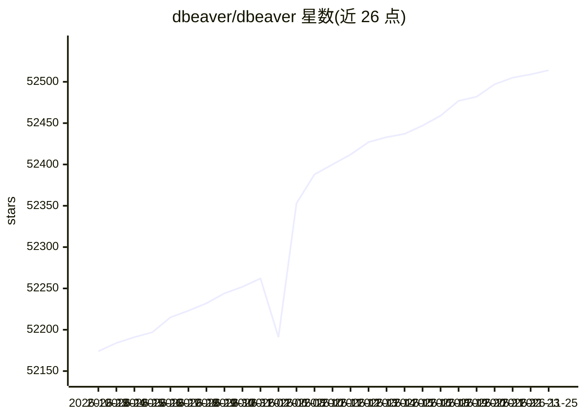

# dbeaver/dbeaver

⭐ 52,514 · Java · Apache-2.0 · 推送 2026-11-23 · [GitHub](https://github.com/dbeaver/dbeaver) · [官网](https://dbeaver.io) · 组织维护

**面向开发者/DBA 的通用数据库工具与 SQL 客户端**

基于 Java/Eclipse RCP 的多平台数据库管理工具，提供 schema 编辑器、SQL 编辑器、数据编辑、ER 图、数据导出/导入/迁移、执行计划、仪表盘、空间数据查看器、SSH 隧道等功能，开箱支持 350+ JDBC/ODBC 驱动，社区版含 130+ 插件。内嵌 AI Chat 视图，可生成/分析/优化 SQL，通过上下文向 LLM 提供库结构与 SQL 方言信息；社区版 AI 接入 OpenAI（可自定义端点）与 Copilot，商业版增加更多 AI 工具与其他 LLM 提供商。

## 筛选速览

| 维度 | 判定 | 备注 |
|---|---|---|
| AI 角色 | `ai-enhanced` | 去掉 AI 部分产品仍成立 |
| 许可风险 | `permissive` | Apache-2.0 |
| 部署形态 | `None` |  |
| 模型依赖 | local-ok | 支持本地模型 |
| 硬件要求 | — | 无带数字的原话,不猜 |
| 安装摩擦 | `medium` | 含编译或系统依赖之一 |
| 成熟度 | `idea` | |

## 动量与使用信号

- 维护:`active` — 距上次 push 0.7 天,年发版 24,367 位贡献者
- 涨星:近 1 天 **+14**(自 20261016 起算)
- 下载:GitHub Release 附件 累计 44,655,152(100 个 release)
- 平台:— · 协议:OLLAMA

## 能力要点

- 开箱支持 350+ 数据库驱动，兼容任何 JDBC/ODBC 驱动的数据库
- 内置 AI Chat：生成/分析/优化 SQL，动态注入库结构与方言上下文
- schema/SQL/数据编辑器、ER 图、数据迁移、仪表盘、SSH 隧道等
- OSGI 插件架构，社区版 130+ 插件，另提供 CloudBeaver 与 dbvr

## 适用场景

- 用一个客户端统一管理 MySQL/PostgreSQL/Oracle/ClickHouse 等多种数据库
- 在 SQL 编辑器里让 AI 帮我生成、分析和优化查询
- 跨库做数据导出、导入与迁移
- 查看执行计划和仪表盘做数据库运维

## 场景标签

`数据分析` · 领域:效率与自动化

## 证据(README 行号)

> L8: Free multi-platform database tool for developers, SQL programmers, database administrators and analysts.
> L10: * Has a lot of features including schema editor, SQL editor, data editor, AI chat, ER diagrams, data export/import/
> L69: - All DBeaver products contain AI Chat view similar to classic LLM chats.
> L73: - AI providers in Community version:

## 星数曲线

2026-10-23 52,174 → 2026-11-25 52,514（+340）

---
*卡片 v1 · prompt 1.4 · 生成 2026-11-22 · 置信度 high · 依据 README sha `a4ec3663f8a8` · [字段定义](../../DATASET.md)*
