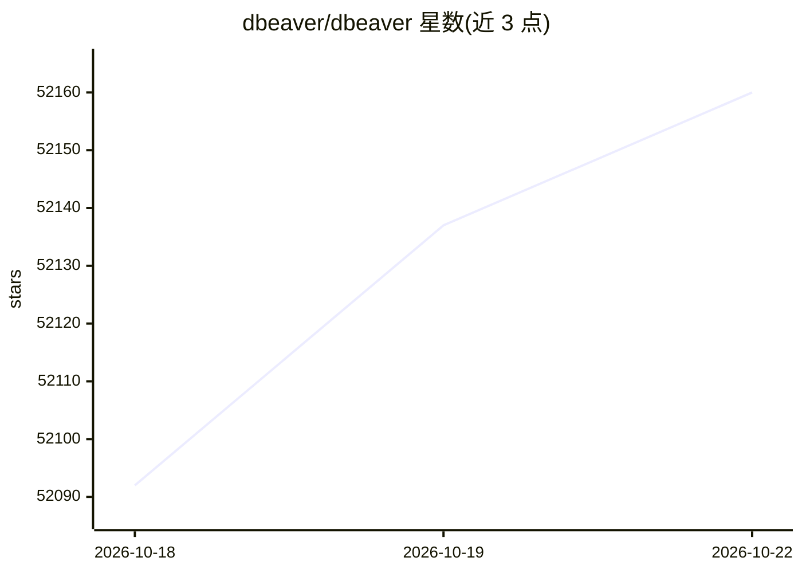

# dbeaver/dbeaver

⭐ 52,174 · Java · Apache-2.0 · 推送 2026-10-22 · [GitHub](https://github.com/dbeaver/dbeaver) · [官网](https://dbeaver.io) · 组织维护

**给开发者和管理员的多平台通用数据库工具与 SQL 客户端**

基于 Java/Eclipse RCP 的桌面数据库管理工具，采用 OSGI 插件架构（社区版 130+ 插件），开箱支持 100+ 数据库驱动，任何有 JDBC/ODBC 驱动的数据库均可连接。功能覆盖 schema/SQL/数据编辑、ER 图、数据导入导出迁移、执行计划、SSH 隧道等。AI 集成方面提供类 LLM 聊天视图，可将数据库结构、SQL 方言等上下文提供给模型以生成/分析/优化 SQL；社区版接入 OpenAI 与 Copilot，Pro 版额外支持 Anthropic/Grok/Azure/Bedrock/Gemini/Ollama。运行需 Java（发行包内置 OpenJDK 25），另有商业化 PRO 版本。

## 筛选速览

| 维度 | 判定 | 备注 |
|---|---|---|
| AI 角色 | `ai-enhanced` | 去掉 AI 部分产品仍成立 |
| 许可风险 | `permissive` | Apache-2.0 |
| 部署形态 | `None` |  |
| 模型依赖 | local-ok | 支持本地模型 |
| 硬件要求 | — | 无带数字的原话,不猜 |
| 安装摩擦 | `medium` | 含编译或系统依赖之一 |
| 成熟度 | `idea` | |

## 动量与使用信号

- 维护:`active` — 距上次 push 0.7 天,年发版 24,367 位贡献者
- 涨星:近 1 天 **+14**(自 20261016 起算)
- 下载:GitHub Release 附件 累计 44,655,152(100 个 release)
- 平台:— · 协议:OLLAMA

## 能力要点

- 开箱支持 100+ 数据库驱动，兼容任意 JDBC/ODBC 数据库
- AI Chat 视图：生成/分析/优化 SQL，注入数据库结构与方言上下文
- OSGI 插件架构，社区版含 130+ 插件
- 提供 GitHub Releases 预编译二进制与每日 Early Access 版本

## 适用场景

- 用一个客户端连接和管理多种数据库
- 借助 AI 聊天在不熟悉 SQL 的情况下查询和维护数据库
- 跨数据库做数据导入导出与迁移
- 通过 ER 图查看和编辑数据库结构

## 场景标签

`代码生成` · 领域:编码与开发

## 证据(README 行号)

> L8: Free multi-platform database tool for developers, SQL programmers, database administrators and analysts.
> L64: - All DBeaver products contain AI Chat view similar to classic LLM chats.
> L71: - Pro versions provide additional AI tools + native support of Anthropic/Grok/Azure/Bedrock/Gemini/Ollama providers

## 星数曲线

2026-10-18 52,092 → 2026-10-22 52,160（+68）

---
*卡片 v1 · prompt 1.4 · 生成 2026-10-18 · 置信度 high · 依据 README sha `a7a40101fcd9` · [字段定义](../../DATASET.md)*
