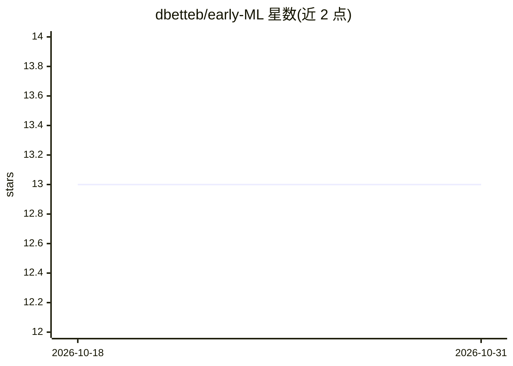

# dbetteb/early-ML

⭐ 13 · Jupyter Notebook · GPL-3.0 · 推送 2026-03-25 · [GitHub](https://github.com/dbetteb/early-ML) · 个人维护

**面向学习者的 Python 机器学习与优化分步教程库**

用 Python 从基础到深度学习逐步讲解机器学习与优化算法的教程仓库：既示范 sklearn、pandas 等经典包的用法，也用纯 Python 重实现机器学习与优化例程，以展示算法背后的原理（如梯度提升机的机制）。按 Python 水平自选主题学习，需 Python 3.5+ 并预装 numpy/scipy/pandas/scikit-learn/jupyter 等包，git clone 后在 jupyter 中按主题练习。主题标签含 nosklearn，强调脱离高级包理解算法。

## 筛选速览

| 维度 | 判定 | 备注 |
|---|---|---|
| AI 角色 | `ai-knowledge` | 知识聚合/清单类 |
| 许可风险 | `viral` | GPL-3.0 |
| 部署形态 | `None` |  |
| 模型依赖 | — | README 未给出锁定关系 |
| 硬件要求 | — | 无带数字的原话,不猜 |
| 安装摩擦 | `low` | 无编译、无系统依赖或容器化 |
| 成熟度 | — | 结构信号不足 |

## 能力要点

- 从 Python 基础到深度学习的分步教程组织
- 用纯 Python 重实现 ML 与优化例程以讲解算法原理
- 同时示范 sklearn/pandas/plotly 等经典数据科学包用法

## 适用场景

- 系统自学机器学习与优化算法的底层原理
- 在掌握 sklearn 等包之前建立算法直觉
- 按 Python 水平自选主题进行练习

## 场景标签

`教程课程` · 领域:学习与行业

## 证据(README 行号)

> L7: A Python step-by-step primer for Machine Learning and Optimization
> L13: Simple and step-by-step. One goal of `early-ML` is to show how to use some classical ML or data-related packages (s

## 星数曲线

2026-10-18 13 → 2026-10-31 13（+0）

---
*卡片 v1 · prompt 1.4 · 生成 2026-10-31 · 置信度 high · 依据 README sha `e3943c924768` · [字段定义](../../DATASET.md)*
