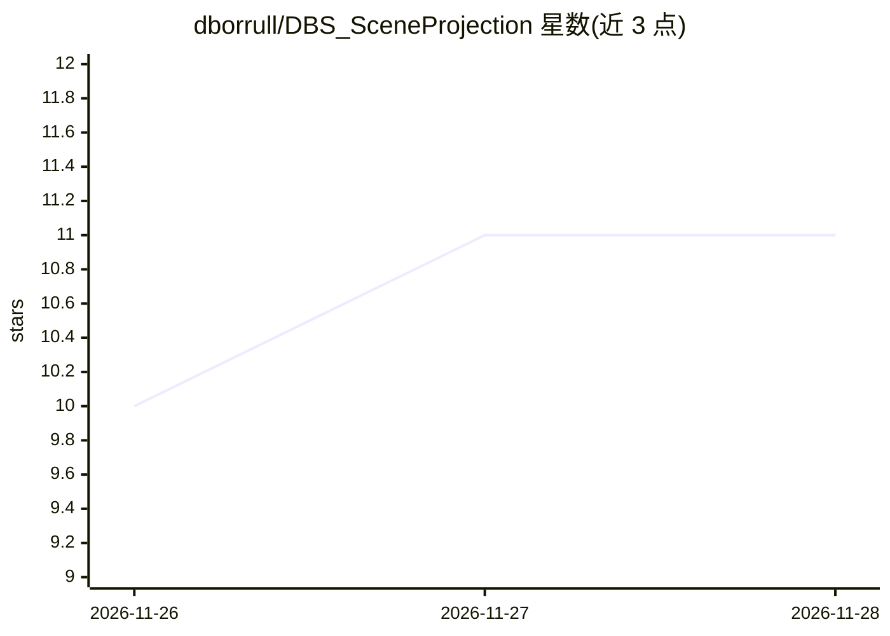

# dborrull/DBS_SceneProjection

⭐ 11 · Python · MIT · 推送 2026-11-24 · [GitHub](https://github.com/dborrull/DBS_SceneProjection) · 个人维护

**给 VFX 合成师从单帧建立 Nuke 相机投影场景的 gizmo**

Nuke gizmo：从 plate 的单帧出发，通过 ComfyUI 调用 MoGe 2 获取深度/点云/焦距、SAM 3 获取实例掩码，用 Blender 变换几何，在 Nuke 中生成投影相机与几何体（地面/墙面/背景板及按标签拟合的 box、cylinder、cone、sphere、revolve、card 或 relief 网格），并接入 Nuke 的 USD 3D 或经典 3D 系统；可选生成 Gaussian splat（Apple SHARP）。几何可贴合跟踪相机的 3D 点以减少投影滑动，输出各对象的滑动像素统计与轮廓偏差检查。依赖 Nuke 17.1、Blender 4.2+ 与 ComfyUI，MIT 许可。

## 筛选速览

| 维度 | 判定 | 备注 |
|---|---|---|
| AI 角色 | `ai-enhanced` | 去掉 AI 部分产品仍成立 |
| 许可风险 | `permissive` | MIT |
| 部署形态 | `None` |  |
| 模型依赖 | — | README 未给出锁定关系 |
| 硬件要求 | — | 无带数字的原话,不猜 |
| 安装摩擦 | `low` | 无编译、无系统依赖或容器化 |
| 成熟度 | — | 结构信号不足 |

## 能力要点

- 单帧生成投影相机与拟合几何，支持 USD 3D 与经典 Nuke 3D 系统
- 通过 ComfyUI 调用 MoGe 2 与 SAM 3，标签用 text:role 行定义
- 几何贴合跟踪点云并输出逐对象滑动像素与轮廓检查
- 支持 extra frames 序列模式与可选 Gaussian splat（SHARP）

## 适用场景

- 合成中的 set extension / 投影绘景，从单帧搭建可投影的场景几何
- 让投影 paint 贴合手持跟踪镜头的点云减少滑动
- 为镜头生成地板、墙体、物体的代理几何与深度校正

## 场景标签

 · 领域:影视特效/合成工具

## 证据(README 行号)

> L7: Nuke gizmo: from one frame of a plate, builds a projection camera and geometry (floor, walls,
> L18: Standalone: it talks to your ComfyUI directly (MoGe 2 for depth, SAM 3 for masks). It does
> L21: With a tracked camera and its point cloud connected, the geometry is snapped to the tracker's

## 星数曲线

2026-11-26 10 → 2026-11-28 11（+1）

---
*卡片 v1 · prompt 1.4 · 生成 2026-11-26 · 置信度 mid · 依据 README sha `f4f4fe747166` · [字段定义](../../DATASET.md)*
