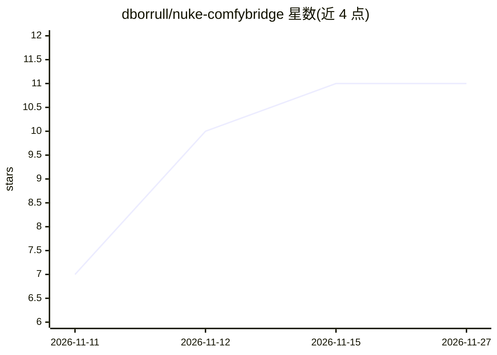

# dborrull/nuke-comfybridge

⭐ 11 · Python · MIT · 推送 2026-11-12 · [GitHub](https://github.com/dborrull/nuke-comfybridge) · 个人维护

**在 Nuke 内运行 ComfyUI 工作流并回传 EXR 的合成插件**

面向 VFX 合成师的 Nuke 节点插件：把 plate 经 Viewer 色彩变换发送到 ComfyUI（本地或 Comfy Cloud），在 Nuke 内调参运行任意图像/视频工作流，结果以 float EXR、scene-linear 回传到节点输出。支持工作流库与参数 knob、最多 3 路额外输入（depth/AOV）、遮罩修补、序列批量模式、版本化输出与 EXR header 元数据回读。状态 v0.11.2，仅在 Windows（Nuke 17.1 NC、ComfyUI 0.38 portable、8 GB GPU）测试过，Linux 未测试。

## 筛选速览

| 维度 | 判定 | 备注 |
|---|---|---|
| AI 角色 | `ai-native` | 本体是模型或模型工具 |
| 许可风险 | `permissive` | MIT |
| 部署形态 | `None` |  |
| 模型依赖 | — | README 未给出锁定关系 |
| 硬件要求 | — | 无带数字的原话,不猜 |
| 安装摩擦 | `low` | 无编译、无系统依赖或容器化 |
| 成熟度 | `idea` | |

## 能力要点

- 从 Nuke 节点直接运行任意 ComfyUI 工作流，结果回传 float EXR
- 色彩往返：经 OCIO/Viewer transform 发送、逆变换回 scene-linear
- 序列模式将整个帧范围作为一个 ComfyUI 任务发送
- EXR header 保存 prompt/workflow/设置，可 reload parameters

## 适用场景

- 在 Nuke 合成里直接跑深度、真实感 pass 等工作流
- 无绿幕生成整段镜头的 alpha matte
- SDR 素材转 HDR 或 layout 转写实渲染

## 场景标签

`图像生成` · 领域:内容生成

## 证据(README 行号)

> L1: ComfyBridge: ComfyUI workflows inside Nuke
> L3: **Run ComfyUI workflows on your plates from inside Nuke** and get the result back as EXR, with the colour pipeline h
> L9: Send a plate → pick a workflow (depth, realism pass, your own…) → tweak its parameters in Nuke → the result comes ou

## 星数曲线

2026-11-11 7 → 2026-11-27 11（+4）

---
*卡片 v1 · prompt 1.4 · 生成 2026-11-18 · 置信度 high · 依据 README sha `1e7be782fe13` · [字段定义](../../DATASET.md)*
