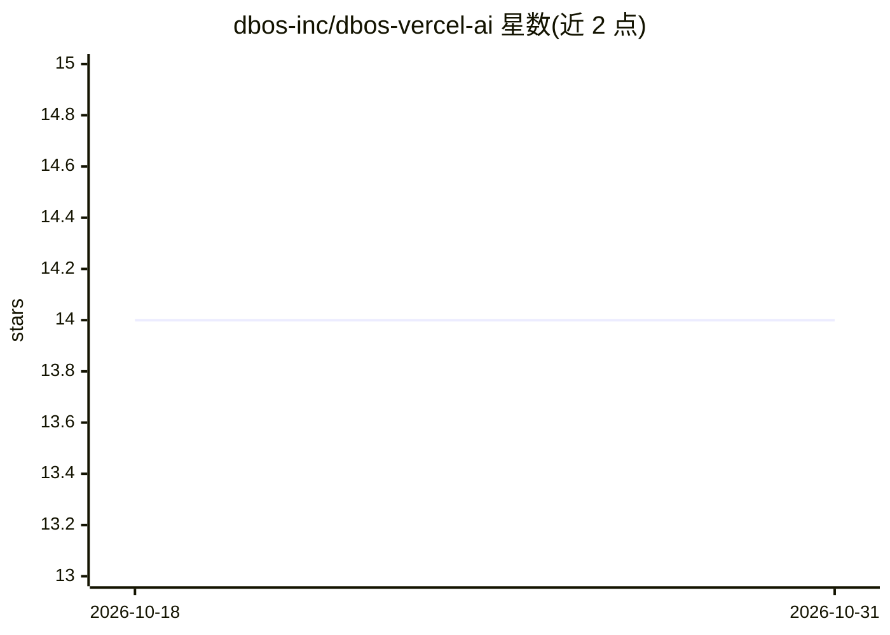

# dbos-inc/dbos-vercel-ai

⭐ 14 · TypeScript · MIT · 推送 2026-09-30 · [GitHub](https://github.com/dbos-inc/dbos-vercel-ai) · [官网](https://docs.dbos.dev) · 组织维护

**为 Vercel AI SDK 提供 Postgres 持久化执行的集成库**

DBOS 推出的 npm 包，将 Vercel AI SDK 构建的 agent 接入 DBOS 持久化执行：用 durableCalls 包装模型、durableTools 包装工具、durableMCPTools 包装 MCP 客户端，使模型调用、工具调用、工具列表均以 checkpoint 形式记录在用户的 Postgres 数据库中，进程中断后可从断点重放恢复。还支持持久化流式输出（可跨进程读取）、子代理（以子工作流实现）、嵌入模型与图像生成调用的持久化。要求 DBOS v4.27+ 或 v5、AI SDK v7+ 及 Postgres 数据库。

## 筛选速览

| 维度 | 判定 | 备注 |
|---|---|---|
| AI 角色 | `ai-ecosystem` | LLM/agent 周边工具 |
| 许可风险 | `permissive` | MIT |
| 部署形态 | `library` | 以包/库形式分发 |
| 模型依赖 | — | README 未给出锁定关系 |
| 硬件要求 | — | 无带数字的原话,不猜 |
| 安装摩擦 | `low` | 无编译、无系统依赖或容器化 |
| 成熟度 | — | 结构信号不足 |

## 能力要点

- durableCalls/durableTools 自动在 Postgres 中 checkpoint agent 的每步动作，中断后从检查点恢复
- 持久化流式输出，可跨进程读取并处理重放时的 superseded 语义
- durableMCPTools 将 MCP 工具列表与调用纳入持久步骤；agentTool 将子代理实现为子工作流
- durableEmbeddingCalls 与 durableImageCalls 覆盖嵌入与图像生成调用

## 适用场景

- 为长时运行的 LLM agent 工作流增加断点恢复能力
- 让流式 agent 输出可被外部客户端或 UI 持久化读取
- 在 MCP 工具与子代理调用上实现可重放的执行记录

## 场景标签

`工作流自动化` · 领域:效率与自动化

## 证据(README 行号)

> L3: DBOS durable execution for the Vercel AI SDK.
> L5: This package makes AI SDK agents durable, backed by your Postgres database.
> L7: Then, this integration automatically checkpoints every action your agents take in Postgres.

## 星数曲线

2026-10-18 14 → 2026-10-31 14（+0）

---
*卡片 v1 · prompt 1.4 · 生成 2026-10-31 · 置信度 high · 依据 README sha `15957698022c` · [字段定义](../../DATASET.md)*
