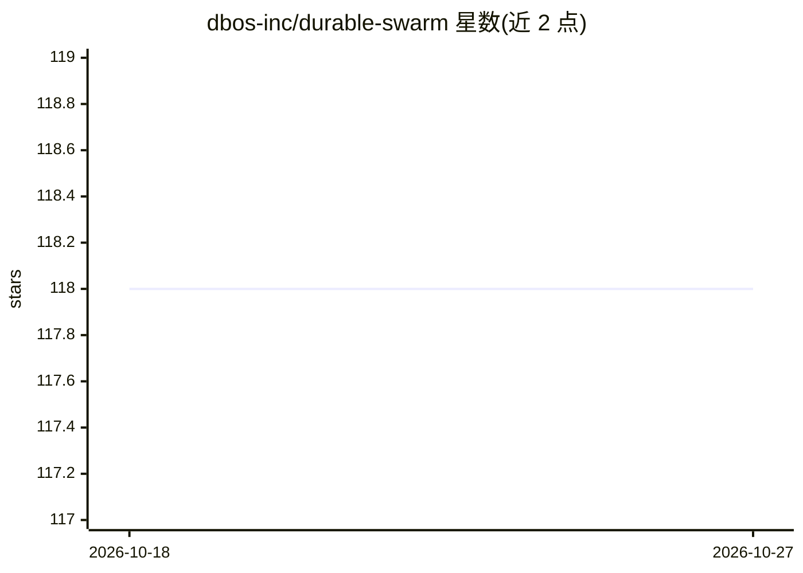

# dbos-inc/durable-swarm

⭐ 118 · Python · MIT · 推送 2026-02-04 · [GitHub](https://github.com/dbos-inc/durable-swarm) · [官网](https://docs.dbos.dev) · 组织维护

**为 OpenAI Swarm 多智能体框架增加持久化执行的适配层**

在 OpenAI Swarm 之上叠加 DBOS 持久化执行的封装：将 Swarm 主循环声明为持久化工作流，把每次 chat completion 与工具调用作为工作流步骤，状态存入 Postgres 数据库；程序中断或重启后可自动从最后完成的步骤恢复。以 drop-in 替换方式使用（DurableSwarm 替代 Swarm），三步即可改造既有 Swarm 应用。需 Python >=3.10、Postgres 与 OpenAI API key；当前不支持流式输出。README 声明本项目已被 DBOS Durable OpenAI Agents SDK 集成取代，建议生产用例迁移。面向构建多智能体系统的开发者。

## 筛选速览

| 维度 | 判定 | 备注 |
|---|---|---|
| AI 角色 | `ai-ecosystem` | LLM/agent 周边工具 |
| 许可风险 | `permissive` | MIT |
| 部署形态 | `library` | 以包/库形式分发 |
| 模型依赖 | — | README 未给出锁定关系 |
| 硬件要求 | — | 无带数字的原话,不猜 |
| 安装摩擦 | `low` | 无编译、无系统依赖或容器化 |
| 成熟度 | — | 结构信号不足 |

## 能力要点

- 以 drop-in 替换方式为 Swarm 增加持久化执行
- 执行状态持久化到 Postgres，中断后自动从最后完成步骤恢复
- 三步改造既有 Swarm 应用
- 提供退款 agent 示例及全套 Swarm 示例的转换版本

## 适用场景

- 让长时间运行的多智能体工作流在故障后自动恢复
- 将既有 Swarm 应用改造为可持久化执行
- 构建需要可靠执行的客户服务/退款处理 agent

## 场景标签

`多智能体` · 领域:Agent 开发

## 证据(README 行号)

> L8: This repository augments OpenAI's Swarm with **durable execution** to help you build **reliable** multi-agent system
> L11: Under the hood, it uses DBOS to persist your agentic workflows' execution state (which workflows are currently exec

## 星数曲线

2026-10-18 118 → 2026-10-27 118（+0）

---
*卡片 v1 · prompt 1.4 · 生成 2026-10-23 · 置信度 mid · 依据 README sha `f930fff6f0db` · [字段定义](../../DATASET.md)*
