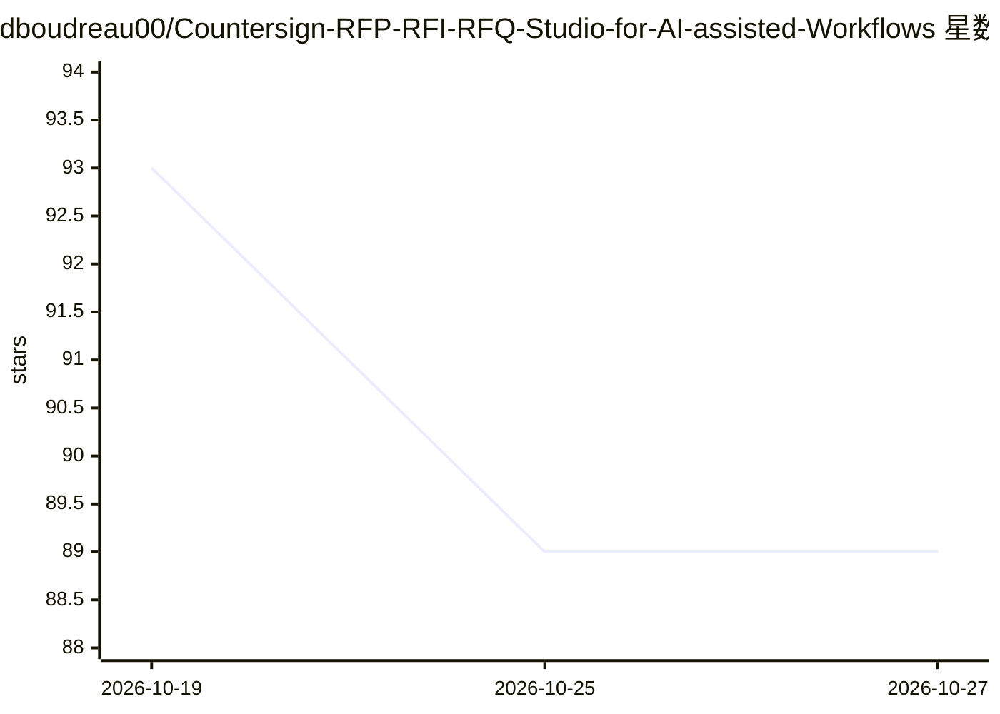

# dboudreau00/Countersign-RFP-RFI-RFQ-Studio-for-AI-assisted-Workflows

⭐ 89 · JavaScript · AGPL-3.0 · 推送 2026-10-21 · [GitHub](https://github.com/dboudreau00/Countersign-RFP-RFI-RFQ-Studio-for-AI-assisted-Workflows) · 个人维护

**自动生成 SaaS RFP/RFI/RFQ 应答的单文件 Web 应用**

单文件 HTML Web 应用：解析最多 500 个文档来源构成知识库，从 RFP（PDF/DOCX/XLSX/CSV/粘贴文本）中抽取问题，基于 RAG 生成带逐题引用与覆盖度评分的回答，可导出 DOCX/XLSX/CSV 或回写原表格。面向需要团队协作应答的企业用户。支持 Claude/Gemini/OpenAI 兼容端点，API key 由浏览器会话或部署的 PHP/Node 代理持有；工作区经 localStorage 保存与 JSON 文件共享。附独立 RAG 引擎 engine.js 与评测套件（35 题留出集、检索/落地性/正确性指标、CI 漂移金丝雀）。限制：代理仅明文 HTTP，需自行做 TLS 与限流。

## 筛选速览

| 维度 | 判定 | 备注 |
|---|---|---|
| AI 角色 | `ai-native` | 本体是模型或模型工具 |
| 许可风险 | `viral` | AGPL-3.0 |
| 部署形态 | `None` |  |
| 模型依赖 | locked-api |  |
| 硬件要求 | — | 无带数字的原话,不猜 |
| 安装摩擦 | `low` | 无编译、无系统依赖或容器化 |
| 成熟度 | — | 结构信号不足 |

## 能力要点

- 从 500 个文档来源构建知识库并生成带逐题引用与覆盖度评分的回答
- 单文件 HTML 部署，无需服务器代码；另提供 PHP/Node 团队代理
- 内置评测套件：precision@k/recall@k/MRR、缺口检测、落地性检查与 CI 金丝雀
- 导出 DOCX/XLSX/CSV 或将回答回写至发标方原表格

## 适用场景

- 团队协作撰写 SaaS 产品的 RFP/RFI/RFQ 应答
- 在企业内网自托管一个共享文档库与应答工作区
- 核验应答回答是否有文档依据并识别知识缺口

## 场景标签

`文档问答` `AI 写作` · 领域:内容生成

## 证据(README 行号)

> L5: A single-file web app that automates SaaS RFP responses: parse a documentation
> L7: CSV or pasted text), generate grounded answers with per-question citations and
> L64: 3. Each user opens **⚙ AI settings** and picks a provider:

## 星数曲线

2026-10-19 93 → 2026-10-27 89（-4）

---
*卡片 v1 · prompt 1.4 · 生成 2026-10-23 · 置信度 high · 依据 README sha `274e2a276f30` · [字段定义](../../DATASET.md)*
