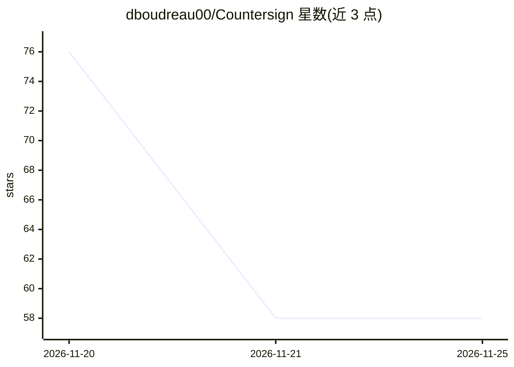

# dboudreau00/Countersign

⭐ 58 · JavaScript · AGPL-3.0 · 推送 2026-11-19 · [GitHub](https://github.com/dboudreau00/Countersign) · 个人维护

**自托管 RFP 应答工具：从自有文档生成带引用的投标答复**

单文件 Web 应用，面向需要响应 RFP/RFI/RFQ 问卷的团队：解析最多 500 个来源的知识库，从 PDF/DOCX/XLSX/CSV 或粘贴文本中提取问题，生成带逐题引用与覆盖度评分的答案，导出为 DOCX/XLSX/CSV 或回写原始表格。回答引擎为独立 Node 18+ RAG 模块，运行于 Anthropic 或 Gemini API；自带评测套件（检索指标、真实性检查、CI 漂移基线）。支持浏览器直用、Claude artifact 部署或 PHP/Node 团队代理三种运行方式。

## 筛选速览

| 维度 | 判定 | 备注 |
|---|---|---|
| AI 角色 | `ai-native` | 本体是模型或模型工具 |
| 许可风险 | `viral` | AGPL-3.0 |
| 部署形态 | `None` |  |
| 模型依赖 | locked-api |  |
| 硬件要求 | — | 无带数字的原话,不猜 |
| 安装摩擦 | `low` | 无编译、无系统依赖或容器化 |
| 成熟度 | — | 结构信号不足 |

## 能力要点

- 从 PDF/DOCX/XLSX/CSV 提取问题并生成带逐题引用的答案
- 评测套件报告 precision@k/recall@k/MRR 与真实性（groundedness）检查
- 单文件 index.html 部署，工作区保存在浏览器 localStorage
- PHP 与 Node 两种团队代理，服务端保管 API key 并强制模型白名单

## 适用场景

- 为 SaaS 投标问卷批量起草有出处的答复
- 团队共享知识库，统一答复口径与覆盖度追踪
- 通过覆盖度评分发现文档无法回答的问题缺口

## 场景标签

`RAG` `文档问答` · 领域:知识与检索

## 证据(README 行号)

> L9: pasted text), generate grounded answers with per-question citations and coverage
> L65: |`engine.js`|Standalone RAG answer engine (Node 18+): knowledge base + retrieval + grounded `/answer` API, on Claud

## 星数曲线

2026-11-20 76 → 2026-11-25 58（-18）

---
*卡片 v1 · prompt 1.4 · 生成 2026-11-20 · 置信度 high · 依据 README sha `567206344d4c` · [字段定义](../../DATASET.md)*
