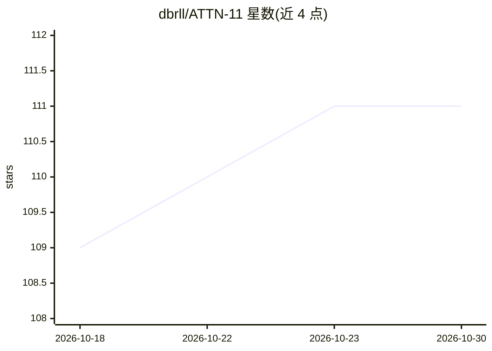

# dbrll/ATTN-11

⭐ 111 · Assembly · 推送 2026-03-30 · [GitHub](https://github.com/dbrll/ATTN-11) · 个人维护

**PDP-11 汇编实现的单层 Transformer，训练数字序列反转任务**

用 PDP-11 汇编语言（MACRO-11）编写的单层单头 encoder-only Transformer，训练任务是反转 8 位数字序列，1,216 参数，在真实 PDP-11/34A 上约 5.5 分钟完成 350 步训练收敛。核心计算基于自研 NN11 定点数栈（Q8 前向/Q15 反向/Q16 累加），以查表替代 exp/log。构建需 MACRO11 汇编器与 obj2bin，运行需带 EIS 指令和 32KB 内存的 PDP-11，或作者自研的电路级模拟器 ll-34（含 WebAssembly 版本）。面向复古计算与底层 ML 实现的探索者。

## 筛选速览

| 维度 | 判定 | 备注 |
|---|---|---|
| AI 角色 | `ai-native` | 本体是模型或模型工具 |
| 许可风险 | `none` | — |
| 部署形态 | `None` |  |
| 模型依赖 | — | README 未给出锁定关系 |
| 硬件要求 | — | 无带数字的原话,不猜 |
| 安装摩擦 | `low` | 无编译、无系统依赖或容器化 |
| 成熟度 | — | 结构信号不足 |

## 能力要点

- 完整 Transformer 训练（含反向传播与 SGD）在裸机 PDP-11 汇编上运行
- NN11 定点运算栈：Q8 前向、Q15 反向、Q16 权重累加器分层设计
- 以 EXPTBL/LOGTBL 查表替代 exp/log，单条 MOV 指令完成表读取
- 二进制仅 6,179 字节，总内存占用 19.2KB

## 适用场景

- 在真实或模拟 PDP-11 硬件上训练并运行一个小型 Transformer
- 研究定点数算术与查表技巧在无浮点单元机器上的实现
- 作为复古硬件上神经网络训练的历史/技术探索项目体验

## 场景标签

 · 领域:复古计算/机器学习实验

## 证据(README 行号)

> L2: **A single-layer, single-head transformer written in PDP-11 assembly language.**
> L18: The goal is to train the Transformer to reverse a sequence of digits.

## 星数曲线

2026-10-18 109 → 2026-10-30 111（+2）

---
*卡片 v1 · prompt 1.4 · 生成 2026-10-23 · 置信度 high · 依据 README sha `64980c9d4226` · [字段定义](../../DATASET.md)*
