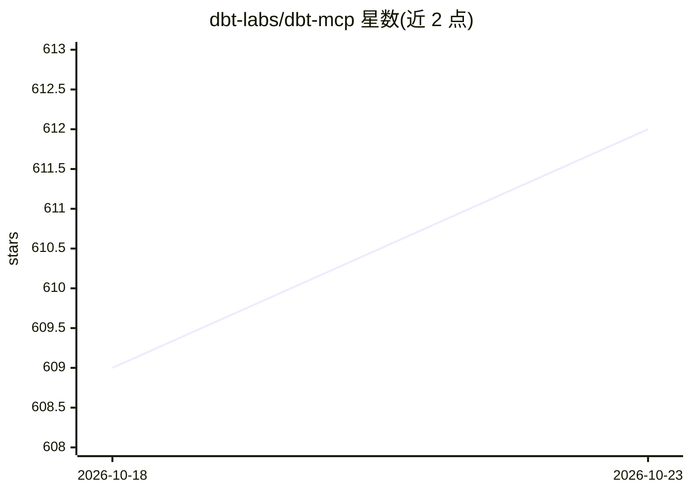

# dbt-labs/dbt-mcp

⭐ 612 · Python · Apache-2.0 · 推送 2026-10-22 · [GitHub](https://github.com/dbt-labs/dbt-mcp) · 组织维护

**让 AI agent 操作 dbt 的 MCP 服务器**

dbt Labs 官方维护的 Model Context Protocol 服务器，向 Claude、Cursor 等 agent 客户端暴露 dbt 相关工具集：SQL 执行与 text_to_sql、Semantic Layer 指标查询、Discovery API 元数据与血缘查询、dbt CLI 命令执行、Platform Admin API 作业管理、模型 YAML 生成与官方文档检索等，覆盖 dbt Core、Fusion 与 dbt Platform。部分血缘工具需通过 dbt Labs VSCE 安装 dbt-lsp，实验性 MCP Bundle 可供 MCPB 感知客户端免配置导入。

## 筛选速览

| 维度 | 判定 | 备注 |
|---|---|---|
| AI 角色 | `ai-ecosystem` | LLM/agent 周边工具 |
| 许可风险 | `permissive` | Apache-2.0 |
| 部署形态 | `None` |  |
| 模型依赖 | — | README 未给出锁定关系 |
| 硬件要求 | — | 无带数字的原话,不猜 |
| 安装摩擦 | `low` | 无编译、无系统依赖或容器化 |
| 成熟度 | — | 结构信号不足 |

## 能力要点

- text_to_sql 从自然语言生成 SQL 并执行于 dbt Platform
- Discovery 工具查询模型、血缘图、健康信号与跨项目 Mesh 模型
- 通过 MCP 暴露 dbt CLI 命令（build/run/test 等）
- 实验性 MCP Bundle（dbt-mcp.mcpb）免额外配置导入

## 适用场景

- 在 Claude 或 Cursor 中对话式查询 dbt 指标与血缘
- 让 agent 执行 dbt 构建与测试命令
- 自动生成模型 YAML 与 staging 模型代码
- 通过 agent 管理 dbt Platform 作业与运行

## 场景标签

`数据分析` `代码生成` · 领域:效率与自动化

## 证据(README 行号)

> L4: This MCP (Model Context Protocol) server provides various tools to interact with dbt. You can use this MCP server to
> L125: Commonly, you will connect the dbt MCP server to an agent product like Claude or Cursor. However, if you are inter

## 星数曲线

2026-10-18 609 → 2026-10-23 612（+3）

---
*卡片 v1 · prompt 1.4 · 生成 2026-10-22 · 置信度 high · 依据 README sha `36a2d6b11d45` · [字段定义](../../DATASET.md)*
