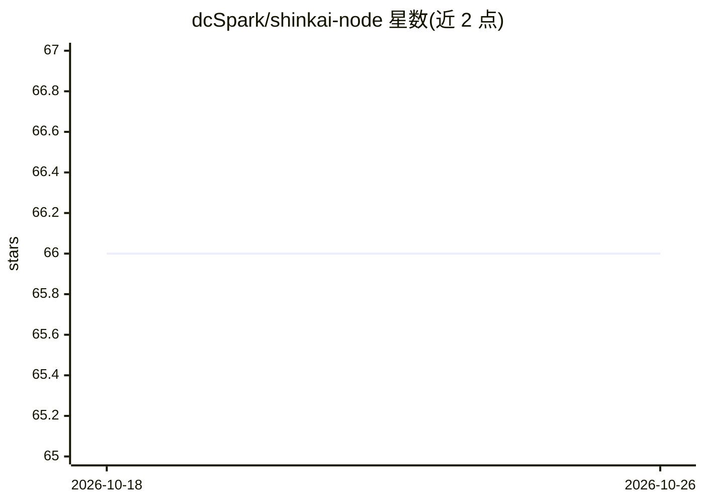

# dcSpark/shinkai-node

⭐ 66 · Rust · Apache-2.0 · 推送 2026-10-21 · [GitHub](https://github.com/dcSpark/shinkai-node) · [官网](https://shinkai.com) · 组织维护

**无代码创建 AI agent 的 Rust 节点后端，含定时任务与原生加密支持**

Shinkai 的 Rust 后端节点：支持不写代码地创建 AI agent、定义任务、调度动作，并声明内建加密（crypto）支持；前端由配套仓库 Shinkai Apps 提供。README 主要覆盖本地编译安装（Rust >= 1.85，脚本或 cargo build）、OpenAPI schema 生成与 Swagger UI、本地与 Docker 化测试流程。配置需设置环境变量，面向自托管部署的开发者/用户。

## 筛选速览

| 维度 | 判定 | 备注 |
|---|---|---|
| AI 角色 | `ai-ecosystem` | LLM/agent 周边工具 |
| 许可风险 | `permissive` | Apache-2.0 |
| 部署形态 | `self-host` | docker 或自建部署 |
| 模型依赖 | — | README 未给出锁定关系 |
| 硬件要求 | — | 无带数字的原话,不猜 |
| 安装摩擦 | `low` | 无编译、无系统依赖或容器化 |
| 成熟度 | — | 结构信号不足 |

## 能力要点

- 以 Rust 实现的 Shinkai 节点，可本地编译运行
- 提供 OpenAPI schema 生成与可选 Swagger UI（编译 feature）
- 支持脚本一键构建与 Docker 化测试流程

## 适用场景

- 自托管运行 Shinkai agent 节点并配合 Shinkai Apps 前端使用
- 在本地环境编译、测试并调试 Shinkai 节点
- 通过 OpenAPI/Swagger UI 查看与调试节点 API

## 场景标签

`Agent 框架` · 领域:Agent 开发

## 证据(README 行号)

> L3:  Shinkai allows you to create AI agents without touching code. Define tasks, schedule actions, and let Shinkai write
> L13: - Rust version >= 1.85 (required for `std::fs::exists` functionality)

## 星数曲线

2026-10-18 66 → 2026-10-26 66（+0）

---
*卡片 v1 · prompt 1.4 · 生成 2026-10-24 · 置信度 low · 依据 README sha `c7b26ff4edfd` · [字段定义](../../DATASET.md)*
