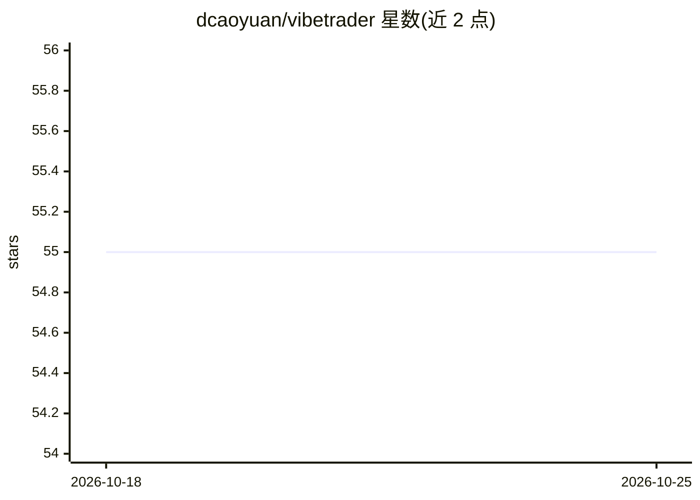

# dcaoyuan/vibetrader

⭐ 55 · TypeScript · Apache-2.0 · 推送 2026-04-21 · [GitHub](https://github.com/dcaoyuan/vibetrader) · [官网](https://dcaoyuan.github.io/vibetrader/) · 个人维护

**面向 AI 的开源交易平台：图表查看与指标截图输出**

VibeTrader 是一个开源交易平台，提供 API 指定股票代码、时间周期与指标等参数，通过 PineTS 支持 Pine Script 指标，并可对图表截图，供 AI 使用。平台同时提供完整的鼠标与键盘手动操作（图表移动、缩放、十字线、绘图工具），由个人开发者维护，声明与 TradingView 无关联。安装方式为 npm install 后 npm run build 运行。

## 筛选速览

| 维度 | 判定 | 备注 |
|---|---|---|
| AI 角色 | `ai-enhanced` | 去掉 AI 部分产品仍成立 |
| 许可风险 | `permissive` | Apache-2.0 |
| 部署形态 | `library` | 以包/库形式分发 |
| 模型依赖 | — | README 未给出锁定关系 |
| 硬件要求 | — | 无带数字的原话,不猜 |
| 安装摩擦 | `low` | 无编译、无系统依赖或容器化 |
| 成熟度 | — | 结构信号不足 |

## 能力要点

- 提供 API 指定 ticker、时间周期与指标
- 通过 PineTS 支持 Pine Script 指标
- 支持对图表截图
- 提供鼠标与键盘的完整图表操作与绘图功能

## 适用场景

- 让 AI 通过 API 与截图获取技术分析图表
- 手动查看和标注 K 线图与技术指标
- 在自有流程中复用 Pine Script 指标

## 场景标签

`金融量化` · 领域:学习与行业

## 证据(README 行号)

> L2: Toward an Open Source AI-Friendly Trading Platform.
> L3: - APIs for specifying ticker, timeframe, and indicators etc.
> L4: - Supports Pine Script indicators via PineTS.

## 星数曲线

2026-10-18 55 → 2026-10-25 55（+0）

---
*卡片 v1 · prompt 1.4 · 生成 2026-10-24 · 置信度 mid · 依据 README sha `876da78edeb6` · [字段定义](../../DATASET.md)*
