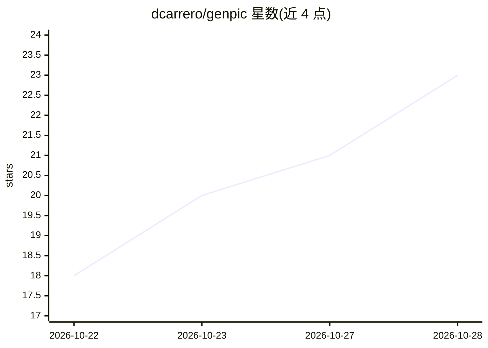

# dcarrero/genpic

⭐ 23 · PHP · MIT · 推送 2026-10-19 · [GitHub](https://github.com/dcarrero/genpic) · [官网](https://genpic.com/) · 个人维护

**已停运的 AI 肖像生成 SaaS 全栈源码（Laravel+Stripe）**

一个完整、经生产验证后开源的 AI 肖像生成 SaaS：用户上传照片，选择 73 种风格之一（油画、浮世绘、动漫等 9 类），生成带水印预览，付费后获得成品。技术栈为 Laravel 11、Livewire 3、Filament 3，接入 fal.ai/OpenRouter/Novita/Evolink 多供应商降级链，Stripe 支付含 EU VAT，Hugging Face NSFW 审核免费方案，5 语言站点。原站于 2026 年 3-10 月运营，零销售后关闭；现以 MIT 许可作为参考代码发布，无维护承诺。

## 筛选速览

| 维度 | 判定 | 备注 |
|---|---|---|
| AI 角色 | `ai-native` | 本体是模型或模型工具 |
| 许可风险 | `permissive` | MIT |
| 部署形态 | `self-host` | docker 或自建部署 |
| 模型依赖 | locked-api |  |
| 硬件要求 | — | 无带数字的原话,不猜 |
| 安装摩擦 | `low` | 无编译、无系统依赖或容器化 |
| 成熟度 | — | 结构信号不足 |

## 能力要点

- 上传→人脸检测→审核→AI 生成→水印预览→Stripe 结账→签名 URL 交付的完整漏斗
- 多 AI 供应商接口：降级链、冷却、按预算每日重排、逐次成本记录
- Stripe Checkout + Stripe Tax 处理 EU VAT，幂等 webhook 与对账命令
- 178 个测试跑在内存 SQLite 上，CI 每次推送执行

## 适用场景

- 参考搭建带付费下载的 AI 图像生成 SaaS
- 学习多供应商 AI 接口与降级、成本控制实现
- 复用多语言 Laravel 站点与 Stripe EU VAT 支付流程

## 场景标签

`图像生成` · 领域:内容生成

## 证据(README 行号)

> L12: GenPic took a photo of you, your family or your friends and turned it into a
> L14: LinkedIn headshot… 73 styles in nine categories. You uploaded a photo, picked a

## 星数曲线

2026-10-22 18 → 2026-10-28 23（+5）

---
*卡片 v1 · prompt 1.4 · 生成 2026-10-28 · 置信度 high · 依据 README sha `9a8c5c71f86b` · [字段定义](../../DATASET.md)*
