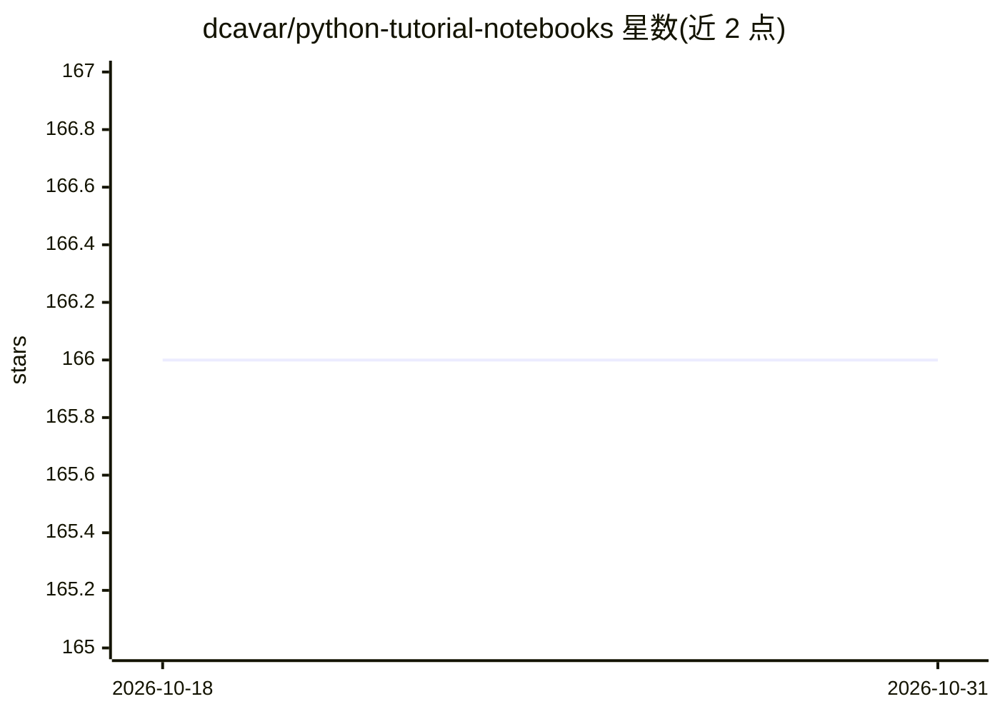

# dcavar/python-tutorial-notebooks

⭐ 166 · Jupyter Notebook · Apache-2.0 · 推送 2026-09-21 · [GitHub](https://github.com/dcavar/python-tutorial-notebooks) · [官网](http://damir.cavar.me/) · 组织维护

**面向计算语言学课程的 Python/NLP/ML/AI 教程笔记本集**

Damir Cavar 自 2016 年起在印第安纳大学计算语言学、NLP、ML、AI 课程中使用的 Jupyter 教程集合，按主题组织：LLM 与嵌入（BERT、OpenAI/Anthropic/Gemini API、Ollama 交互）、图数据库与知识图谱（Neo4j、RDFlib、YAGO）、文本分类、spaCy/NLTK/Stanza 管道、HMM/PCFG 解析等。运行需 Python 3.x 与 Jupyter，通过 git clone 获取，各笔记本依赖的模块版本各异，作者标注安装说明已过时且依赖文档待完善。

## 筛选速览

| 维度 | 判定 | 备注 |
|---|---|---|
| AI 角色 | `ai-knowledge` | 知识聚合/清单类 |
| 许可风险 | `permissive` | Apache-2.0 |
| 部署形态 | `library` | 以包/库形式分发 |
| 模型依赖 | — | README 未给出锁定关系 |
| 硬件要求 | — | 无带数字的原话,不猜 |
| 安装摩擦 | `low` | 无编译、无系统依赖或容器化 |
| 成熟度 | — | 结构信号不足 |

## 能力要点

- 覆盖 LLM/嵌入、知识图谱、文本分类、NLP 管道等多主题的教程笔记本
- 包含 spaCy、NLTK、Stanza、scikit-learn、Keras 等工具的分步教程
- 含 BERT、OpenAI/Anthropic/Gemini API、Ollama 等 LLM 交互示例

## 适用场景

- 课堂教学或自学 NLP/ML/AI 的 Python 实践材料
- 查找 spaCy/NLTK/知识图谱等具体工具的入门示例
- 了解从 N-gram 到 Transformer 的课程实践路径

## 场景标签

`教程课程` · 领域:学习与行业

## 证据(README 行号)

> L7: The notebooks below are my personal course material used in classes since 2016 until now (2026). Feel free to use th
> L106: The files in this folder are [Jupyter]-based tutorials for NLP, ML, AI in Python for classes I teach in Computatio

## 星数曲线

2026-10-18 166 → 2026-10-31 166（+0）

---
*卡片 v1 · prompt 1.4 · 生成 2026-10-22 · 置信度 mid · 依据 README sha `774ef6dbe759` · [字段定义](../../DATASET.md)*
