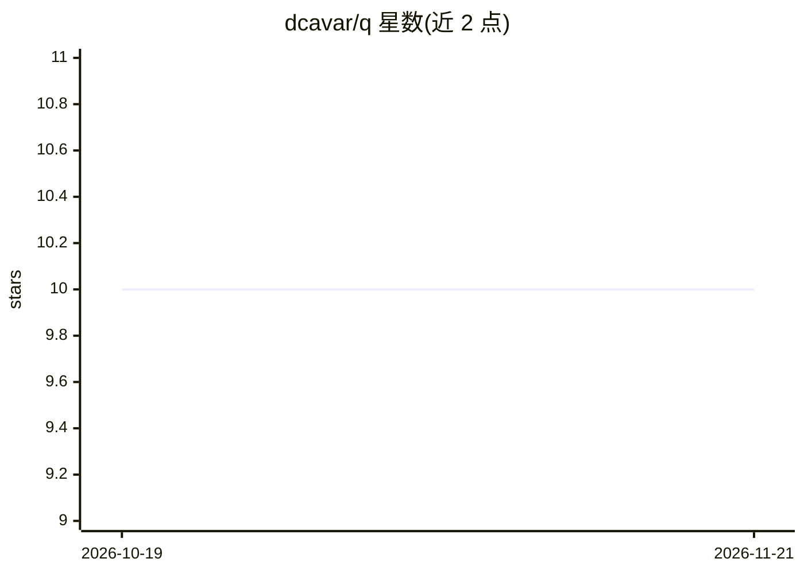

# dcavar/q

⭐ 10 · Jupyter Notebook · Apache-2.0 · 推送 2026-04-23 · [GitHub](https://github.com/dcavar/q) · [官网](https://nlp-lab.org/quantumnlp/) · 组织维护

**量子计算与 AI 研读小组的教学资料与代码仓库**

印第安纳大学 Damir Cavar 实验室自 2018 年夏开始的量子计算与 AI 研读小组（reading group）资料库，收录代码、笔记、链接与教材清单，聚焦机器学习、自然语言处理与 AI 方向的量子算法。内容涵盖 Qiskit 2.x 材料、IBM Quantum 量子信息基础课程、书籍文献列表（量子计算与深度学习/自然语言处理教材）、量子计算模拟器清单与信息站点链接。仓库以分享和推广教学材料为目的，未提供安装说明或可执行产品。

## 筛选速览

| 维度 | 判定 | 备注 |
|---|---|---|
| AI 角色 | `ai-knowledge` | 知识聚合/清单类 |
| 许可风险 | `permissive` | Apache-2.0 |
| 部署形态 | `None` |  |
| 模型依赖 | — | README 未给出锁定关系 |
| 硬件要求 | — | 无带数字的原话,不猜 |
| 安装摩擦 | `low` | 无编译、无系统依赖或容器化 |
| 成熟度 | — | 结构信号不足 |

## 能力要点

- 收录 Qiskit 2.x 学习材料与 IBM Quantum 量子信息基础课程
- 提供量子计算与深度学习/NLP 的书籍文献清单
- 汇总量子计算模拟器列表（Quantiki 等）

## 适用场景

- 自学量子计算与量子机器学习入门材料
- 查找 Qiskit 相关课程与文献
- 组织类似的量子计算读书会/研读小组

## 场景标签

`教程课程` · 领域:学习与行业

## 证据(README 行号)

> L11: This repo contains the code, notes, links, and other material from the reading group on:
> L17: The purpose of this repo and material is to share and promote educational material and examples for Quantum Algorit

## 星数曲线

2026-10-19 10 → 2026-11-21 10（+0）

---
*卡片 v1 · prompt 1.4 · 生成 2026-11-19 · 置信度 high · 依据 README sha `f6356d907a6b` · [字段定义](../../DATASET.md)*
