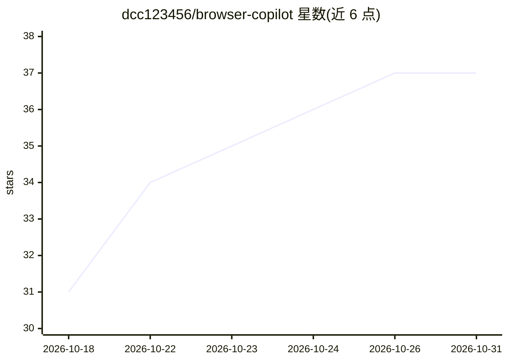

# dcc123456/browser-copilot

⭐ 37 · TypeScript · NOASSERTION · 推送 2026-10-30 · [GitHub](https://github.com/dcc123456/browser-copilot) · [官网](https://dcc123456.github.io/browser-copilot/) · 个人维护 · 中文 README

**Chrome 侧栏 AI 助手：读取当前页面并代你点击、填表、执行流程**

Chrome（Manifest V3）侧边栏扩展，接入任意 OpenAI 兼容端点（DeepSeek、火山方舟、OpenRouter、本地 Ollama/LM Studio 等，自带 key）。读取当前页内容后代用户执行操作：点击、输入、填表、切标签页、走完多步流程；提供四种自主级别（纯聊天到全自动），半自动下每个动作需用户确认。支持可复用 Skills、可视化录制工作流（56 种块类型）、定时任务、Feishu/Lark 远程指令、通过本地适配器向 Claude Code/Codex 等 MCP 客户端提供浏览器工具箱。本地存储、无遥测。安装方式为下载 release zip 解压加载，或 Node 20+ 从源码构建；需模型支持 function calling 才能自主操作。

## 筛选速览

| 维度 | 判定 | 备注 |
|---|---|---|
| AI 角色 | `ai-native` | 本体是模型或模型工具 |
| 许可风险 | `none` | NOASSERTION |
| 部署形态 | `library` | 以包/库形式分发 |
| 模型依赖 | local-ok | 支持本地模型 |
| 硬件要求 | — | 无带数字的原话,不猜 |
| 安装摩擦 | `low` | 无编译、无系统依赖或容器化 |
| 成熟度 | — | 结构信号不足 |

## 能力要点

- 四种自主级别：纯聊天/只读/半自动审批/全自动
- 工作流可视化录制（56 种块类型）+ 定时/快捷键/匹配页面触发
- 通过本地适配器向 Claude Code/Codex/Trae 等 MCP 客户端提供浏览器工具箱
- 任意 OpenAI 兼容端点多供应商接入，数据本地文件存储、无遥测

## 适用场景

- 让 AI 代填表单、走完下单或设置流程，逐步审批每个点击
- 把重复性标准（评审清单、风格指南）做成一键 Skill 应用到页面
- 录制成工作流并定时/触发式自动执行
- 在飞书群里远程下达指令，让浏览器里的任务执行并回报结果

## 场景标签

`浏览器自动化` `工作流自动化` `AI 助手` · 领域:效率与自动化

## 证据(README 行号)

> L10: Your AI assistant that actually _uses_ the web for you. Open the side panel,
> L15: - 🧠 **Works with the model you already use.** Any OpenAI-compatible endpoint:
> L42: - 🤝 **Your coding agent can drive it too.** Claude Code, Codex, Trae — any

## 星数曲线

2026-10-18 31 → 2026-10-31 37（+6）

---
*卡片 v1 · prompt 1.4 · 生成 2026-10-25 · 置信度 high · 依据 README sha `acf62bb06fcd` · [字段定义](../../DATASET.md)*
