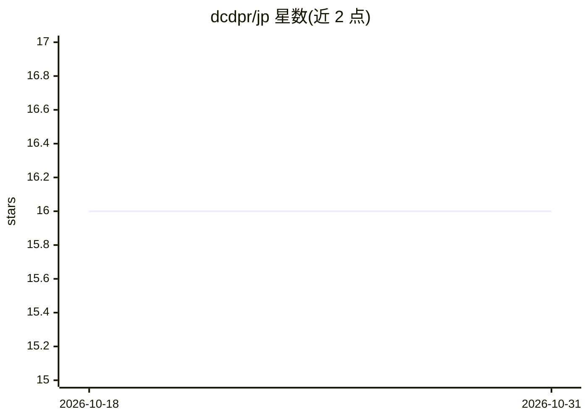

# dcdpr/jp

⭐ 16 · Rust · Apache-2.0 · 推送 2026-10-30 · [GitHub](https://github.com/dcdpr/jp) · 组织维护

**面向开发者的 LLM 无关结对编程命令行工具**

Jean-Pierre (jp) 是 Rust 编写的单文件静态二进制 CLI 编程助手，定位为可融入现有 Unix 工作流（管道、shell 组合）的 LLM 结对编程工具。设计原则包括 provider-agnostic（不绑定单一 LLM 后端，可接入前沿模型、本地推理运行时与聚合服务）、默认私密安全（无隐式网络访问与静默工具执行）、沙箱插件扩展与 TOML 配置。以 cargo 从源码安装，通过 jp init 建立工作区、jp q 发起查询、管理会话。项目处于活跃开发期，文档可能出现破坏性变更。

## 筛选速览

| 维度 | 判定 | 备注 |
|---|---|---|
| AI 角色 | `ai-native` | 本体是模型或模型工具 |
| 许可风险 | `permissive` | Apache-2.0 |
| 部署形态 | `library` | 以包/库形式分发 |
| 模型依赖 | — | README 未给出锁定关系 |
| 硬件要求 | — | 无带数字的原话,不猜 |
| 安装摩擦 | `low` | 无编译、无系统依赖或容器化 |
| 成熟度 | `idea` | |

## 能力要点

- 单文件静态二进制，与管道和 shell 组合的 Unix 风格设计
- provider-agnostic：不绑定任何 LLM 供应商
- 默认无隐式网络访问与静默工具执行
- 沙箱化插件扩展与 TOML 工作区配置

## 适用场景

- 在终端中以自然语言向 LLM 发起编程问答
- 在 Vim 等既有编辑器工作流中嵌入 LLM 结对编程
- 本地优先接入自选推理运行时的编程助手

## 场景标签

`编码 Agent` · 领域:编码与开发

## 证据(README 行号)

> L3: > A command-line toolkit to support you in your daily work as a software
> L5: > Built to integrate into your existing workflows, providing a secure, powerful
> L19: JP is built to be: **[provider-agnostic][1]**, because your workflow shouldn't

## 星数曲线

2026-10-18 16 → 2026-10-31 16（+0）

---
*卡片 v1 · prompt 1.4 · 生成 2026-10-30 · 置信度 high · 依据 README sha `8c7374e36f96` · [字段定义](../../DATASET.md)*
