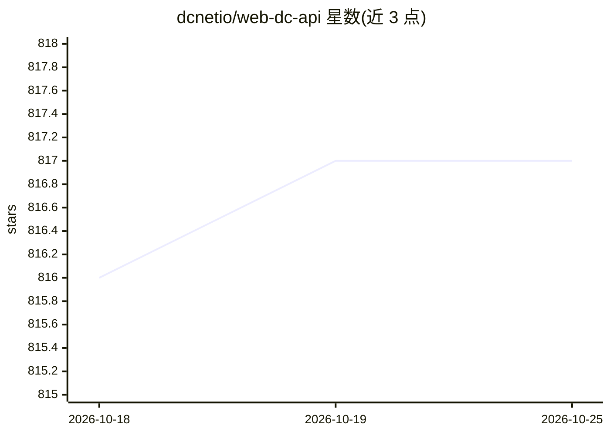

# dcnetio/web-dc-api

⭐ 817 · JavaScript · 推送 2026-09-20 · [GitHub](https://github.com/dcnetio/web-dc-api) · 组织维护 · 中文 README

**面向浏览器的去中心化应用 SDK：钱包身份+私有数据库+共享存储+AI 代理**

TypeScript SDK，把钱包登录与身份、用户私有 ThreadDB、共享 KeyValue（含类型化 EntityRepository 仓储）、加密文件与流式读取、评论/消息、实时通信 RTM/RTC、协作白板、支付和 AI 代理（流式模型调用、MCP、实时语音）统一在一个 DC 实例中，面向构建无需自建服务器的去中心化 Web 应用。运行目标是现代浏览器（ES2020/Web Crypto/IndexedDB/WebSocket），包入口不兼容 Node.js SSR 顶层导入；提供 ESM/CommonJS/类型与 npm/CDN 两种接入。

## 筛选速览

| 维度 | 判定 | 备注 |
|---|---|---|
| AI 角色 | `ai-enhanced` | 去掉 AI 部分产品仍成立 |
| 许可风险 | `none` | — |
| 部署形态 | `library` | 以包/库形式分发 |
| 模型依赖 | — | README 未给出锁定关系 |
| 硬件要求 | — | 无带数字的原话,不猜 |
| 安装摩擦 | `low` | 无编译、无系统依赖或容器化 |
| 成熟度 | — | 结构信号不足 |

## 能力要点

- 钱包登录身份与跨设备同步的用户私有 ThreadDB
- 共享 KeyValue 存储与 ThemePermission 权限体系（含 ONLY_WRITE 匿名投稿等模式）
- 加密文件上传、CID 下载与可 seek 流，配套 Service Worker 媒体访问
- AI 代理模块支持流式模型调用、MCP 与实时语音

## 适用场景

- 构建无自建服务器的去中心化 Web 应用
- 管理用户私有结构化数据与多人共享状态、排行榜
- 在浏览器应用中做加密文件存储与流式媒体播放
- 通过 dc.aiproxy 接入 AI 模型调用与 MCP 能力

## 场景标签

`Agent 框架` · 领域:Agent 开发

## 证据(README 行号)

> L3: `web-dc-api` 是面向浏览器的去中心化应用 SDK。它把钱包身份、用户私有数据库、共享 KeyValue、文件、评论、消息、AI 代理、实时通信、白板和支付能力统一在一个 `DC` 实例中。
> L21: |AI 与 MCP|`dc.aiproxy`|流式模型调用、MCP、异步资源、实时语音|`DoAIProxyCall`、`GenerateAndPollAIResource`|服务配置和用户授权|

## 星数曲线

2026-10-18 816 → 2026-10-25 817（+1）

---
*卡片 v1 · prompt 1.4 · 生成 2026-10-21 · 置信度 high · 依据 README sha `45242a5bb2f9` · [字段定义](../../DATASET.md)*
