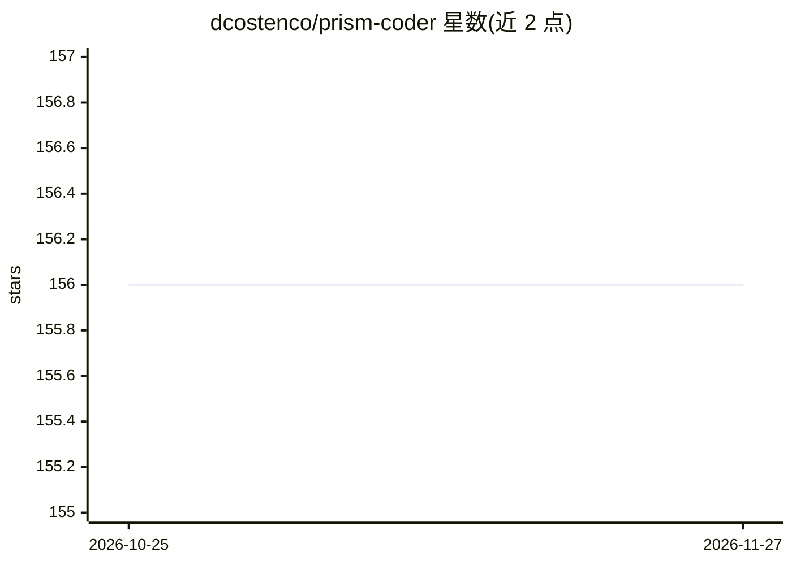

# dcostenco/prism-coder

⭐ 156 · TypeScript · Apache-2.0 · 推送 2026-11-26 · [GitHub](https://github.com/dcostenco/prism-coder) · [官网](https://synalux.ai/prism-mcp) · 组织维护

**为 AI 编码 agent 提供跨会话持久记忆与本地推理的 MCP 服务器**

以 MCP 服务器形式为 Claude、Cursor 等工具提供跨会话长期记忆：会话交接笔记、TODO 与可配置上下文层级，检索采用 ACT-R 排序（相关性+新近度+频率+关联）。内置 2B–27B 开源权重模型用于本地离线工具路由，附带 savings 计量表统计本地承接的 token 量。免费本地使用无需账号与 API key；云同步、更高模型档位与团队功能需 Synalux 订阅。通过 npm 安装或作为 Claude Code/Codex 插件安装。

## 筛选速览

| 维度 | 判定 | 备注 |
|---|---|---|
| AI 角色 | `ai-ecosystem` | LLM/agent 周边工具 |
| 许可风险 | `permissive` | Apache-2.0 |
| 部署形态 | `library` | 以包/库形式分发 |
| 模型依赖 | local-ok | 支持本地模型 |
| 硬件要求 | — | 无带数字的原话,不猜 |
| 安装摩擦 | `low` | 无编译、无系统依赖或容器化 |
| 成熟度 | — | 结构信号不足 |

## 能力要点

- 跨会话持久记忆与 ACT-R 自动记忆排序
- 本地 Ollama/oMLX 推理，按已装模型与 RAM 自动选 2B/4B/9B/27B
- prism savings 输出可审计的本地承接 token 统计
- prism connect 一次配置 Claude Code、Cursor、Gemini CLI、Codex 等多个宿主

## 适用场景

- 让编码 agent 在重启后延续项目上下文与 TODO
- 将部分工具调用路由到本地模型以减少云端 token 消耗
- 在无网络或无 API key 环境运行 AI 编码工作流

## 场景标签

`Agent 记忆` `模型网关` · 领域:Agent 开发

## 证据(README 行号)

> L22: Prism Coder is an MCP server that gives Claude, Cursor, and other AI tools long-term memory that survives across se
> L47: - **One setup for every agent** — `prism connect` configures Claude Code,

## 星数曲线

2026-10-25 156 → 2026-11-27 156（+0）

---
*卡片 v1 · prompt 1.4 · 生成 2026-11-27 · 置信度 high · 依据 README sha `91bb86c2098a` · [字段定义](../../DATASET.md)*
