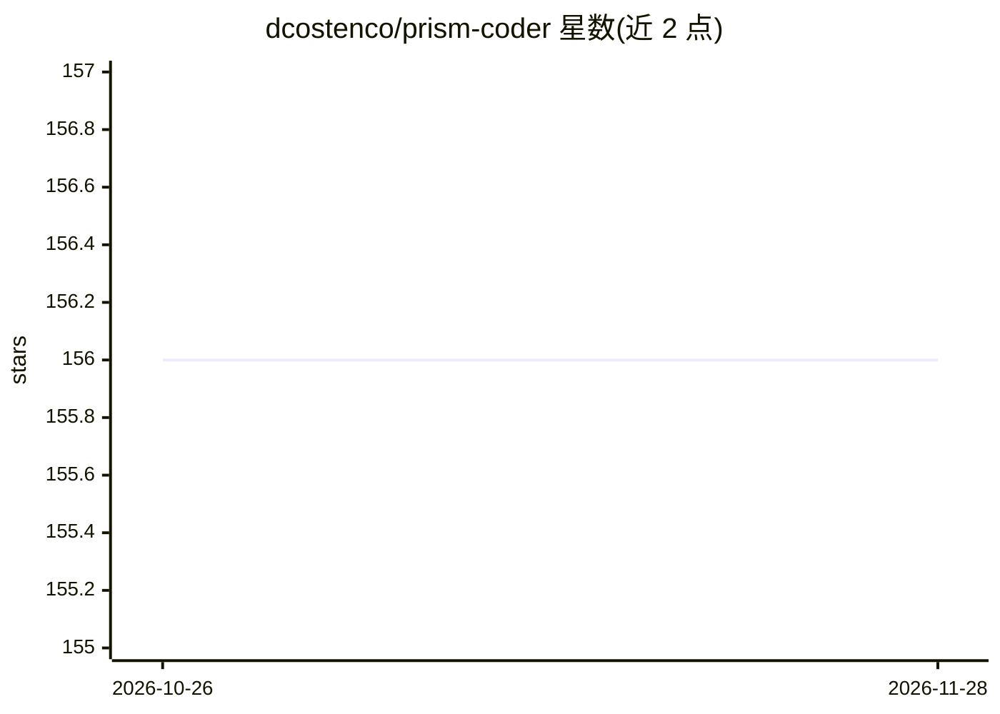

# dcostenco/prism-coder

⭐ 156 · TypeScript · Apache-2.0 · 推送 2026-11-27 · [GitHub](https://github.com/dcostenco/prism-coder) · [官网](https://synalux.ai/prism-mcp) · 组织维护

**给 AI 编码代理提供跨会话持久记忆的本地 MCP 服务器**

Prism Coder 是一个 MCP 服务器，为 Claude、Cursor 等 AI 工具提供跨会话持久记忆，包含交接笔记、TODO 与知识图谱，检索基于 ACT-R 排序（相关性/新近性/频率/关联）。自带 2B–27B 开放权重模型用于本地离线工具路由，无需账户或 API key；`prism savings` 以 token 计量本地服务所节省的云端调用量。`prism connect` 可一键配置多个宿主客户端。Synalux 付费订阅解锁云同步、更高级模型与团队功能；普通 Ollama 图像后端目前拒绝执行。

## 筛选速览

| 维度 | 判定 | 备注 |
|---|---|---|
| AI 角色 | `ai-ecosystem` | LLM/agent 周边工具 |
| 许可风险 | `permissive` | Apache-2.0 |
| 部署形态 | `library` | 以包/库形式分发 |
| 模型依赖 | local-ok | 支持本地模型 |
| 硬件要求 | — | 无带数字的原话,不猜 |
| 安装摩擦 | `low` | 无编译、无系统依赖或容器化 |
| 成熟度 | — | 结构信号不足 |

## 能力要点

- 跨会话持久记忆，支持 ACT-R 自动排序（可关闭）
- 自带 2B–27B 开放权重模型本地离线工具路由，无需 API key
- 可审计的本地节省计量（prism savings，以 token 报告）
- prism connect 一次配置 Claude Code、Cursor、Codex、Gemini CLI 等宿主

## 适用场景

- 让 Claude Code / Cursor 在多次会话间保留项目上下文与交接笔记
- 在本地离线环境下运行 AI 编码代理的工具路由
- 统计本地推理替代云端模型所节省的 token 量

## 场景标签

`Agent 记忆` `知识图谱` · 领域:Agent 开发

## 证据(README 行号)

> L22: Prism Coder is an MCP server that gives Claude, Cursor, and other AI tools long-term memory that survives across se
> L51: - **One setup for every agent** — `prism connect` configures Claude Code,
> L153: Prism works locally without an account, API key, or cloud subscription. Add a

## 星数曲线

2026-10-26 156 → 2026-11-28 156（+0）

---
*卡片 v1 · prompt 1.4 · 生成 2026-11-28 · 置信度 high · 依据 README sha `a9b30a607be0` · [字段定义](../../DATASET.md)*
