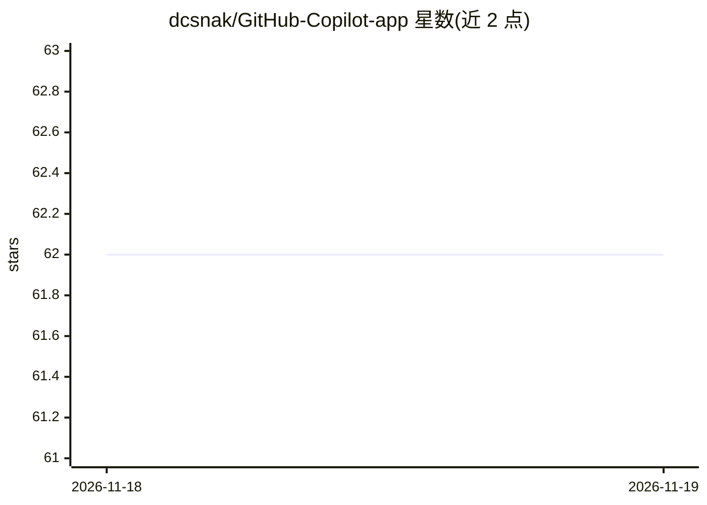

# dcsnak/GitHub-Copilot-app

⭐ — · [GitHub]() · 组织维护

**管理 GitHub Copilot agent 工作流的桌面应用**

GitHub 官方的桌面应用，面向开发者管理从想法到 pull request 的 agent 驱动开发流程。核心机制：本地会话在独立 git worktree 中隔离运行，云会话在 GitHub 托管的隔离环境中执行；Canvas 画布将 agent 的计划、终端、diff、浏览器预览呈现为可检查的共享界面；My Work 聚合会话、issue 与 PR 上下文；Automations 将提示词转为定时/后台任务；Agent Merge 辅助 PR 通过评审与合并条件。前提是 Git 与 GitHub Copilot 订阅（或自带模型 provider 的 key）。

## 筛选速览

| 维度 | 判定 | 备注 |
|---|---|---|
| AI 角色 | `ai-ecosystem` | LLM/agent 周边工具 |
| 许可风险 | `permissive` | — |
| 部署形态 | `desktop` | 安装包/桌面程序 |
| 模型依赖 | — | README 未给出锁定关系 |
| 硬件要求 | — | 无带数字的原话,不猜 |
| 安装摩擦 | `low` | 无编译、无系统依赖或容器化 |
| 成熟度 | — | 结构信号不足 |

## 能力要点

- 本地会话运行在隔离 git worktree，云会话运行在 GitHub 托管环境
- Canvas 将 agent 计划、终端、diff、预览呈现为可编辑可检查界面
- Automations 将可重复提示与工作流转为定时或后台任务
- 支持 BYOK 使用自有模型 provider，无需 Copilot 订阅

## 适用场景

- 在多个仓库间并行驱动多个 agent 处理 bug、issue 与评审反馈
- 集中查看会话、issue、PR 以决定下一步关注点
- 将重复性提示词配置为定时后台任务

## 场景标签

`编码 Agent` · 领域:编码与开发

## 证据(README 行号)

> L13: The GitHub Copilot app is an agent-native desktop experience for managing software work from idea to pull request. 
> L15: The app is built for parallel agent-driven development. Each local session runs in its own isolated git worktree, a

## 星数曲线

2026-11-18 62 → 2026-11-19 62（+0）

---
*卡片 v1 · prompt 1.4 · 生成 2026-11-19 · 置信度 high · 依据 README sha `db7fa9f8df45` · [字段定义](../../DATASET.md)*
