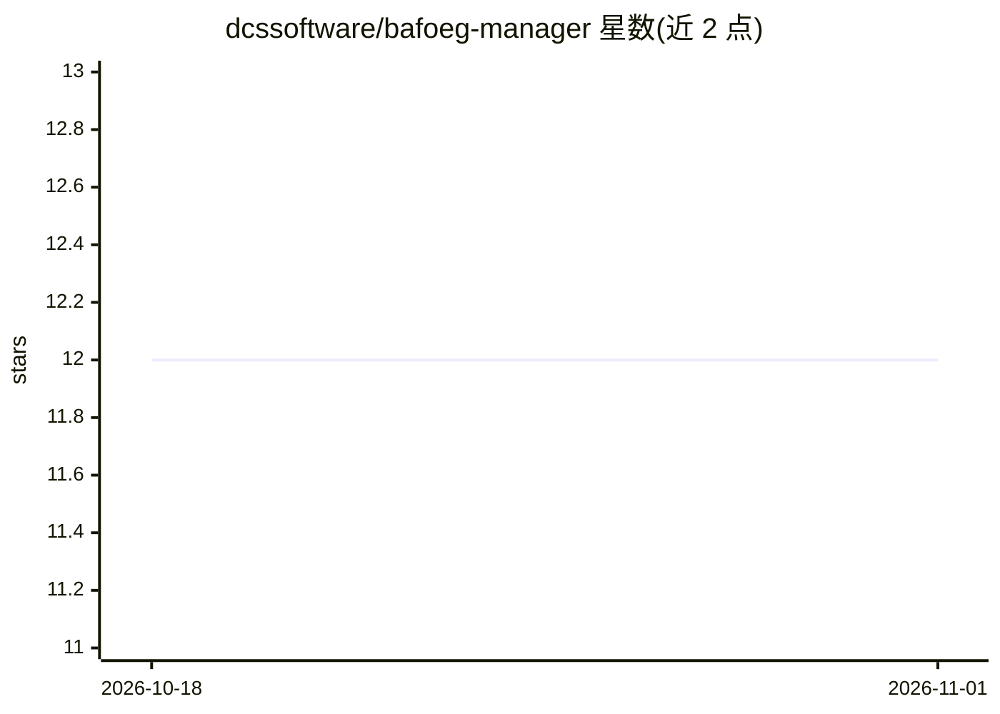

# dcssoftware/bafoeg-manager

⭐ 12 · 推送 2026-08-18 · [GitHub](https://github.com/dcssoftware/bafoeg-manager) · 组织维护

**给 BAföG 办事员的申请管理门户，含本地 AI 助手**

面向德国 BAföG（联邦教育促进法助学金）Sachbearbeiter（办事员）的应用：在统一门户中处理数字与纸质申请，汇集相关信息、自动执行必要计算，并在办事员查看前检查申请完整性。界面包含申请人总览、学校总览与电子档案（E-Akte）视图。仓库描述中提及包含本地运行的 KI 助手（如 Ministral 14B）以辅助处理；还款与所谓"BAföG Bot"仅为草案，尚未完成。README 未给出安装运行说明，且项目已迁移至 Codeberg。

## 筛选速览

| 维度 | 判定 | 备注 |
|---|---|---|
| AI 角色 | `ai-enhanced` | 去掉 AI 部分产品仍成立 |
| 许可风险 | `none` | — |
| 部署形态 | `None` |  |
| 模型依赖 | — | README 未给出锁定关系 |
| 硬件要求 | — | 无带数字的原话,不猜 |
| 安装摩擦 | `low` | 无编译、无系统依赖或容器化 |
| 成熟度 | — | 结构信号不足 |

## 能力要点

- 统一门户处理数字与纸质 BAföG 申请
- 自动执行必要计算并在人工查看前检查完整性
- 申请人/学校总览与电子档案（E-Akte）视图
- 描述提及本地 KI 助手（如 Ministral 14B）

## 适用场景

- BAföG 办事员在一个门户内处理各类申请
- 借助自动计算与完整性预检减少人工核查工作
- 通过电子档案视图查阅申请人材料

## 场景标签

`AI 助手` · 领域:对话与助手

## 证据(README 行号)

> L6: Diese Anwendung wurde für BAföG Sachbearbeiter\*innen entwickelt, damit sie digitale und analoge Anträge in einem Po

## 星数曲线

2026-10-18 12 → 2026-11-01 12（+0）

---
*卡片 v1 · prompt 1.4 · 生成 2026-11-01 · 置信度 low · 依据 README sha `938a2e6f5845` · [字段定义](../../DATASET.md)*
