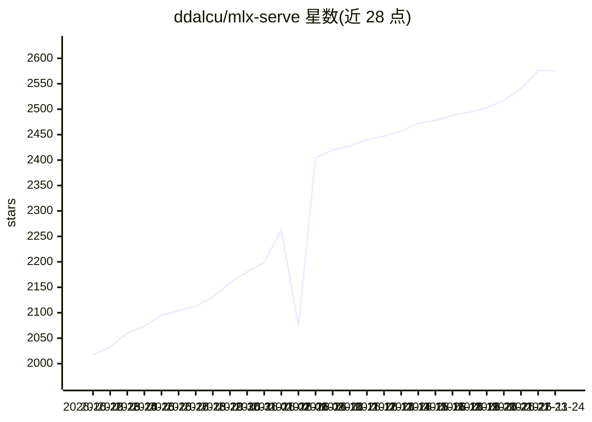

# ddalcu/mlx-serve

⭐ 2,588 · Zig · NOASSERTION · 推送 2026-11-23 · [GitHub](https://github.com/ddalcu/mlx-serve) · [官网](https://mlxserve.com/) · 个人维护 · 中文 README

**面向 Apple Silicon 的本地推理服务器与应用，兼容 OpenAI/Anthropic API**

在 Mac 上本地运行开放模型的推理服务器加桌面应用：提供聊天、代码 Agent 接入、图像/视频/音乐/语音/3D 生成、语音转写与文档问答。服务器在单一端口同时提供 OpenAI、Anthropic Messages 与 Ollama 三种 API，支持流式、工具调用与 JSON schema。无需 Python，MIT 许可，可离线运行；提供 macOS 应用、iPhone 版、Linux/NVIDIA GPU 构建与源码编译（Zig 后端、构建时编译 MLX 与 llama.cpp）。

## 筛选速览

| 维度 | 判定 | 备注 |
|---|---|---|
| AI 角色 | `ai-ecosystem` | LLM/agent 周边工具 |
| 许可风险 | `permissive` | NOASSERTION |
| 部署形态 | `None` |  |
| 模型依赖 | local-ok | 支持本地模型 |
| 硬件要求 | — | 无带数字的原话,不猜 |
| 安装摩擦 | `low` | 无编译、无系统依赖或容器化 |
| 成熟度 | — | 结构信号不足 |

## 能力要点

- 单端口提供 OpenAI、Anthropic Messages、Ollama 三种兼容 API
- 本地模型接入 Claude Code、Codex 等编码 Agent
- 支持 MLX 与 GGUF 模型，128GB Mac 可经 SSD 读取专家运行超大模型
- 媒体能力：FLUX.2 图像、LTX-Video 视频、Qwen3-TTS 语音克隆、Hunyuan3D 等

## 适用场景

- 在 Mac 上离线跑本地大模型并让现有 OpenAI/Anthropic 客户端直接对接
- 用本地模型驱动 Claude Code 等编码 Agent
- 本地生成图像、视频、音乐或做语音转写与会议纪要

## 场景标签

`推理引擎` `编码 Agent` `图像生成` `语音合成` · 领域:编码与开发

## 证据(README 行号)

> L5: Run open models on your Mac: chat, coding agents, images, video, music, speech and 3D. One native app and one local 
> L54: - **The APIs your tools already use.** OpenAI chat, completions and Responses, Anthropic Messages and Ollama, all o
> L37: The server listens on `http://localhost:11234`. Point any OpenAI, Anthropic or Ollama client at it, or open that ad

## 星数曲线

2026-10-22 2,017 → 2026-11-24 2,576（+559）

---
*卡片 v1 · prompt 1.4 · 生成 2026-11-23 · 置信度 high · 依据 README sha `425539da0f29` · [字段定义](../../DATASET.md)*
