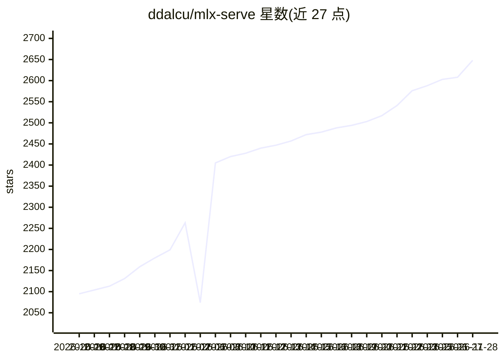

# ddalcu/mlx-serve

⭐ 2,648 · Zig · NOASSERTION · 推送 2026-11-27 · [GitHub](https://github.com/ddalcu/mlx-serve) · [官网](https://mlxserve.com/) · 个人维护

**Apple Silicon 本地 LLM 推理服务器，兼容 OpenAI/Anthropic API**

面向 Apple Silicon Mac 的本地推理服务器与 macOS 原生应用，用 Zig 后端与 Swift 前端实现，不含 Python。支持聊天、编程 agent 接入、图像/视频/音乐/语音/3D 生成与 30 种语言转写；同一端口提供 OpenAI、Anthropic 与 Ollama 兼容 API，含流式输出、工具调用与视觉。按 Mac 内存推荐模型，支持 GGUF 与 MLX 模型，可在离线状态运行；另提供 iPhone 版与 NVIDIA GPU 的 Linux 构建。

## 筛选速览

| 维度 | 判定 | 备注 |
|---|---|---|
| AI 角色 | `ai-ecosystem` | LLM/agent 周边工具 |
| 许可风险 | `permissive` | NOASSERTION |
| 部署形态 | `None` |  |
| 模型依赖 | local-ok | 支持本地模型 |
| 硬件要求 | — | 无带数字的原话,不猜 |
| 安装摩擦 | `low` | 无编译、无系统依赖或容器化 |
| 成熟度 | — | 结构信号不足 |

## 能力要点

- 单端口提供 OpenAI、Anthropic 与 Ollama 三种兼容 API，支持流式、工具调用与视觉
- 按内存推荐模型（16 GB 至 256 GB 分级表），支持 MLX 架构模型与任意 GGUF
- mlx-serve launch claude 可在本地模型上运行 Claude Code 等编程 agent
- 媒体能力覆盖 FLUX.2、LTX-Video、Qwen3-TTS 语音克隆、Hunyuan3D 等

## 适用场景

- 在 Mac 上离线运行本地模型做日常聊天与文档问答
- 把 Claude Code、Codex 等编程 agent 指向本地模型
- 通过兼容 API 让现有 OpenAI/Anthropic 客户端访问本地模型
- 本地生成图片、视频、音乐与语音转写会议记录

## 场景标签

`推理引擎` `图像生成` `视频生成` `语音合成` · 领域:内容生成

## 证据(README 行号)

> L5: Run open models on your Mac: chat, coding agents, images, video, music, speech and 3D. One native app and one local 
> L37: The server listens on `http://localhost:11234`. Point any OpenAI, Anthropic or Ollama client at it, or open that ad
> L54: - **The APIs your tools already use.** OpenAI chat, completions and Responses, Anthropic Messages and Ollama, all o

## 星数曲线

2026-10-26 2,095 → 2026-11-28 2,648（+553）

---
*卡片 v1 · prompt 1.4 · 生成 2026-11-27 · 置信度 high · 依据 README sha `3fa1fa20df0c` · [字段定义](../../DATASET.md)*
