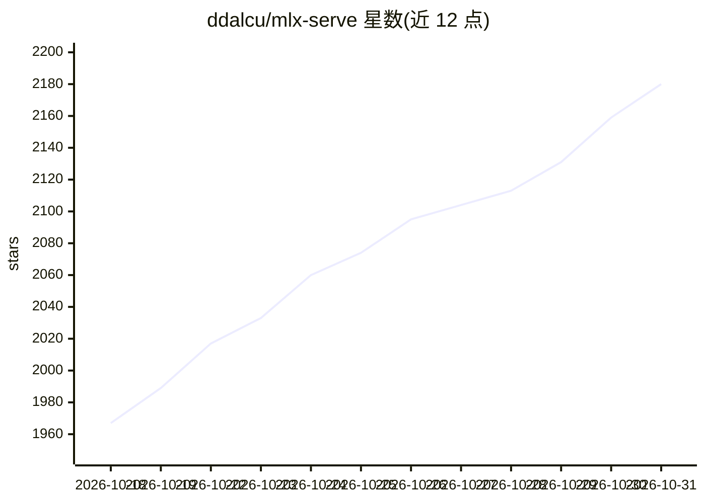

# ddalcu/mlx-serve

⭐ 2,180 · Zig · NOASSERTION · 推送 2026-10-30 · [GitHub](https://github.com/ddalcu/mlx-serve) · [官网](https://mlxserve.com/) · 个人维护 · 中文 README

**Apple Silicon 本地 LLM 与媒体推理服务器及原生应用**

面向 Mac 用户的本地推理服务：以 Zig 实现后端、Swift 构建 macOS 应用，不依赖 Python，离线运行且 MIT 许可。提供 OpenAI、Anthropic 与 Ollama 兼容 API，单端口监听 localhost:11234，支持聊天、代码 agent 接入（Claude Code/Codex 等）、图片/视频/音乐/语音/3D 生成、30 种语言转写，以及超内存模型从 SSD 流式读取与双机 Thunderbolt 5 协同。亦可经 Homebrew 或终端 CLI 安装纯服务器；另有 iPhone 版与 NVIDIA GPU 的 Linux 构建。macOS 应用需 26.2 及以上。

## 筛选速览

| 维度 | 判定 | 备注 |
|---|---|---|
| AI 角色 | `ai-ecosystem` | LLM/agent 周边工具 |
| 许可风险 | `permissive` | NOASSERTION |
| 部署形态 | `None` |  |
| 模型依赖 | local-ok | 支持本地模型 |
| 硬件要求 | — | 无带数字的原话,不猜 |
| 安装摩擦 | `low` | 无编译、无系统依赖或容器化 |
| 成熟度 | — | 结构信号不足 |

## 能力要点

- OpenAI/Anthropic/Ollama 三套 API 兼容，单端口服务
- 图片/视频/音乐/语音/3D 生成（FLUX.2、LTX-Video、ACE-Step、Qwen3-TTS 等）
- 128GB Mac 可经 SSD 流式运行超大 MoE 模型，支持双机 Thunderbolt 5 合跑
- 按内存推荐模型的分级表与实测解码速度数据

## 适用场景

- 在 Mac 上本地运行开源模型并给现有 OpenAI/Anthropic 客户端供 API
- 让 Claude Code/Codex 等编码 agent 接本地模型
- 离线生成图片、音乐、语音与 3D 内容

## 场景标签

`推理引擎` `图像生成` `语音合成` `语音识别` · 领域:内容生成

## 证据(README 行号)

> L5: Run open models on your Mac: chat, coding agents, images, video, music, speech and 3D. One native app and one local 
> L37: The server listens on `http://localhost:11234`. Point any OpenAI, Anthropic or Ollama client at it, or open that ad
> L54: - **The APIs your tools already use.** OpenAI chat, completions and Responses, Anthropic Messages and Ollama, all o

## 星数曲线

2026-10-18 1,967 → 2026-10-31 2,180（+213）

---
*卡片 v1 · prompt 1.4 · 生成 2026-10-21 · 置信度 high · 依据 README sha `eca33acc861b` · [字段定义](../../DATASET.md)*
