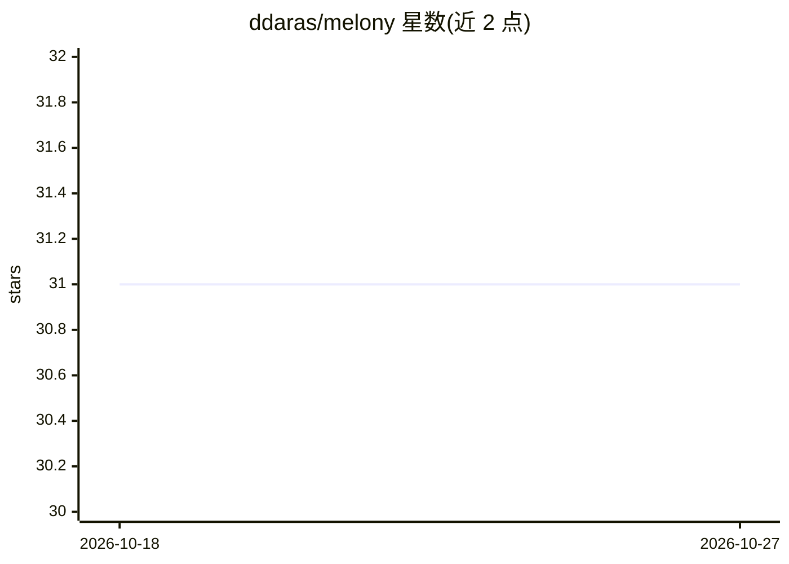

# ddaras/melony

⭐ 31 · TypeScript · 推送 2026-05-04 · [GitHub](https://github.com/ddaras/melony) · [官网](https://melony.dev) · 个人维护

**TypeScript 事件驱动的 AI agent 编排框架**

Melony 是一个用于构建 AI agent 的轻量事件驱动框架，核心机制为 `Event → Handler → Events` 编排循环：事件触发处理器、处理器再产生新事件。提供类型安全的 Builder API、插件系统（复用 handler）、面向 HITL 的审批与护栏事件处理，以及 `@melony/react` 包（providers/hooks）将 React 应用接入 Melony 事件流。推荐通过克隆 Next.js Starter 模板起步，仓库内含 landing、studio、express 三个应用。

## 筛选速览

| 维度 | 判定 | 备注 |
|---|---|---|
| AI 角色 | `ai-ecosystem` | LLM/agent 周边工具 |
| 许可风险 | `none` | — |
| 部署形态 | `library` | 以包/库形式分发 |
| 模型依赖 | — | README 未给出锁定关系 |
| 硬件要求 | — | 无带数字的原话,不猜 |
| 安装摩擦 | `low` | 无编译、无系统依赖或容器化 |
| 成熟度 | — | 结构信号不足 |

## 能力要点

- Event → Handler → Events 事件编排循环作为核心运行时
- 类型安全的 Fluent Builder API 与插件系统
- @melony/react 提供 React providers/hooks 接入事件流
- HITL 审批与护栏实现在事件处理器中

## 适用场景

- 用 TypeScript 构建事件驱动的 AI agent 应用
- 在 React 前端中接入 agent 事件流并渲染交互流程
- 为 agent 加入人工审批与护栏环节

## 场景标签

`Agent 框架` · 领域:Agent 开发

## 证据(README 行号)

> L3: Fast, unopinionated, minimalist event-based framework for building AI agents.
> L7: Melony is to AI agents what Express is to web servers — a tiny, flexible orchestration loop: `Event → Handler → Even

## 星数曲线

2026-10-18 31 → 2026-10-27 31（+0）

---
*卡片 v1 · prompt 1.4 · 生成 2026-10-26 · 置信度 mid · 依据 README sha `444f5637923f` · [字段定义](../../DATASET.md)*
