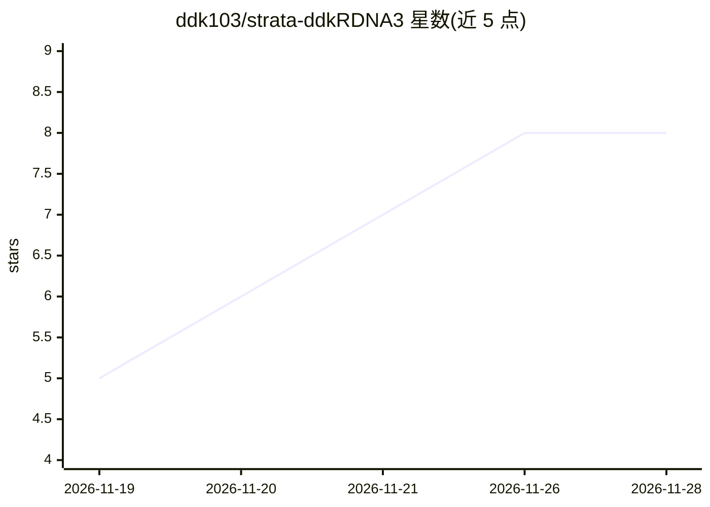

# ddk103/strata-ddkRDNA3

⭐ 8 · C++ · MIT · 推送 2026-11-24 · [GitHub](https://github.com/ddk103/strata-ddkRDNA3) · 个人维护

**面向 AMD RX 7900 XTX 的 Strata 调优分叉与实测记录**

基于 Niko1221/Strata v0.1.49.1 的 gfx1100 定向分叉，跨 14 个文件移植栈隔离、CPU expert 延迟、pool 相位融合、prefill 事件去重、grammar 约束输出等改动（均注明原作者）。gfx1100/ 目录保存完整调优记录：44 个环境变量、启动旗标、16/32 次采样的量化研究、会话缓存与队列参数实测数据。仅在一台 RX 7900 XTX + Windows 11 + HIP 环境验证，不提供预编译二进制与模型权重，部分开关会改变输出。

## 筛选速览

| 维度 | 判定 | 备注 |
|---|---|---|
| AI 角色 | `ai-ecosystem` | LLM/agent 周边工具 |
| 许可风险 | `permissive` | MIT |
| 部署形态 | `desktop` | 安装包/桌面程序 |
| 模型依赖 | — | README 未给出锁定关系 |
| 硬件要求 | — | 无带数字的原话,不猜 |
| 安装摩擦 | `high` | 编译与系统依赖俱全 |
| 成熟度 | — | 结构信号不足 |

## 能力要点

- 移植并记录 STRATA_STACK_ISOLATE 等 7 类开关，含归属链 NOTICE.md
- gfx1100/ 目录保存 16/32 次运行的量化与解码性能实测记录
- 会话缓存调至 16384 MiB 后 96K token 会话复用率 97–100%
- 记录两个可复现的上游问题

## 适用场景

- 在 RX 7900 XTX + Windows HIP 上运行调优后的 Strata 引擎
- 多 agent 会话交替场景下减少 25–40 秒的冷 prefill
- 参照 gfx1100/configs/fork-8090.example.json 配置引擎

## 场景标签

`推理引擎` `模型量化` · 领域:训练与推理

## 证据(README 行号)

> L5: **An RDNA3 (gfx1100) focused fork of Strata — built for the AMD RX 7900 XTX on Windows HIP.**
> L71: |Engine|Strata **0.1.49.1**, built from this tree|

## 星数曲线

2026-11-19 5 → 2026-11-28 8（+3）

---
*卡片 v1 · prompt 1.4 · 生成 2026-11-20 · 置信度 high · 依据 README sha `02c3722d41de` · [字段定义](../../DATASET.md)*
