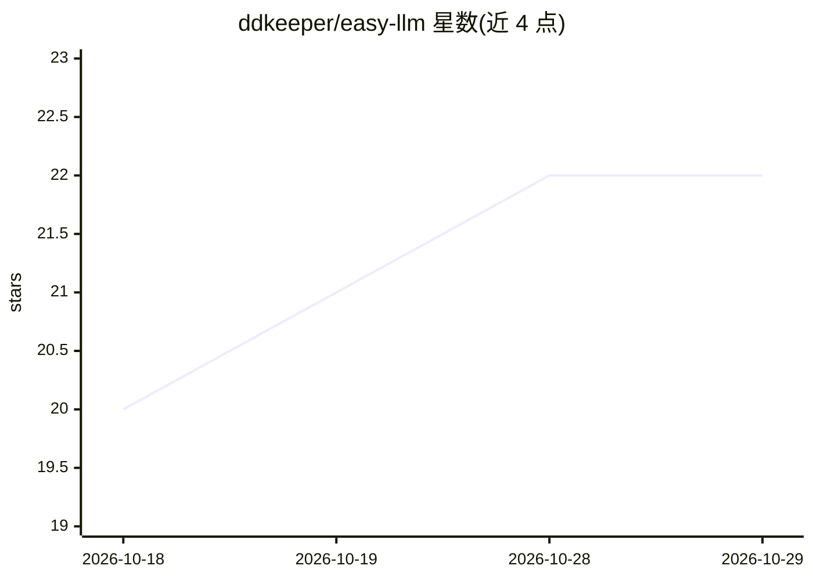

# ddkeeper/easy-llm

⭐ 22 · Jupyter Notebook · 推送 2026-10-18 · [GitHub](https://github.com/ddkeeper/easy-llm) · [官网](https://www.bilibili.com/video/BV1NV8t6AE4T/?vd_source=0034741cbe350a95fe85ffdab1bdc34a) · 个人维护 · 中文 README

**斯坦福 CS 336 零基础手搓大模型教程配套代码**

以斯坦福公开课 CS 336 为基底的中文视频教程配套代码仓库：按课程作业文档的任务点形式，从代码块 0 起逐步拼出大模型训练与推理所需代码，覆盖数据、训练、评估、推理全流程，并补充原课程略过的基础知识与代码细节。运行环境为 Conda + Python 3.10 + PyTorch 2.5（CUDA 12.1），提供 TinyStories 与 OpenWebText 分词后数据集及配套分词器。

## 筛选速览

| 维度 | 判定 | 备注 |
|---|---|---|
| AI 角色 | `ai-knowledge` | 知识聚合/清单类 |
| 许可风险 | `none` | — |
| 部署形态 | `None` |  |
| 模型依赖 | — | README 未给出锁定关系 |
| 硬件要求 | — | 无带数字的原话,不猜 |
| 安装摩擦 | `medium` | 含编译或系统依赖之一 |
| 成熟度 | — | 结构信号不足 |

## 能力要点

- 按 CS 336 作业任务点引导逐步实现大模型训练与推理代码
- 提供 TinyStories / OpenWebText 分词后数据集与预训练分词器
- 初学者向：先补基础再切入，配代码与配图

## 适用场景

- 零基础跟做 CS 336 课程，动手实现大模型
- 短期掌握大模型数据/训练/评估/推理核心内容
- 作为入门项目用于考研复试或实习简历

## 场景标签

`教程课程` `模型训练` · 领域:学习与行业

## 证据(README 行号)

> L1: 本项目为**【斯坦福 cs336】零基础手搓大模型系列视频**的配套项目。
> L4: 本系列以斯坦福（Stanford）大学公开课 **CS 336: Language Modeling from Scratch** 为基底，以初学者友好、内容聚焦、讲解接地气的方式，介绍现代大语言模型的原理与代码实现。
> L6: 整体讲解逻辑遵循 CS 336 课程作业文档，以任务点（Problem）的形式引导大家写出代码块 0、代码块 1……最终拼出大模型训练与推理所需要的一切代码。在讲解内容上会额外补充文档中略过的背景知识、基础概念与代码细节。

## 星数曲线

2026-10-18 20 → 2026-10-29 22（+2）

---
*卡片 v1 · prompt 1.4 · 生成 2026-10-28 · 置信度 high · 依据 README sha `3ad834a10790` · [字段定义](../../DATASET.md)*
