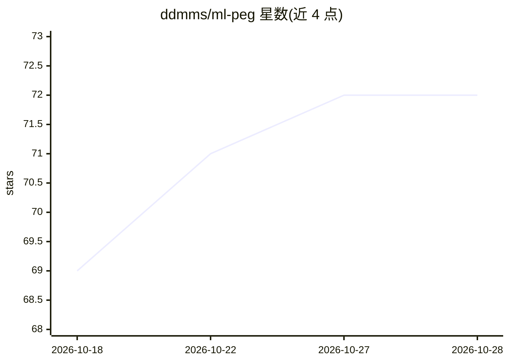

# ddmms/ml-peg

⭐ 72 · Python · GPL-3.0 · 推送 2026-10-27 · [GitHub](https://github.com/ddmms/ml-peg) · [官网](https://ddmms.github.io/ml-peg/) · 组织维护

**机器学习原子间势（MLIP）的性能与外推评测框架**

面向计算材料学/分子模拟研究者的 ML 力场（MLIP）评测工具：通过 ml_peg 命令行运行基准测试（如 X23）、分析与结果展示，内置 app 子命令提供本地网页应用（端口 8050）。支持列出可用的测试、分析与模型，可对 mace-mp-0a、orb-v3-consv-inf-omat 等模型执行计算；提供 Jupyter Notebook 教程指导添加新基准。以 PyPI 包分发，另有 Linux/amd64 Docker 镜像与 Compose 配置。README 的 Features 部分标注 More details coming soon，功能描述尚未完善。

## 筛选速览

| 维度 | 判定 | 备注 |
|---|---|---|
| AI 角色 | `ai-ecosystem` | LLM/agent 周边工具 |
| 许可风险 | `viral` | GPL-3.0 |
| 部署形态 | `self-host` | docker 或自建部署 |
| 模型依赖 | — | README 未给出锁定关系 |
| 硬件要求 | — | 无带数字的原话,不猜 |
| 安装摩擦 | `low` | 无编译、无系统依赖或容器化 |
| 成熟度 | — | 结构信号不足 |

## 能力要点

- ml_peg CLI 提供 calc/analyse/app/download/list 五个子命令
- 可在指定 MLIP 模型（如 mace-mp-0a、orb-v3-consv-inf-omat）上运行 X23 等基准测试
- 提供 Docker/Podman 镜像与 Docker Compose 部署方式
- 提供添加新基准与模型的 Jupyter Notebook 教程

## 适用场景

- 为我的分子模拟选型前对比不同 MLIP 的基准表现
- 评估 MLIP 在训练数据之外的外推能力
- 本地部署网页应用浏览评测结果

## 场景标签

`模型评测` · 领域:评测与运维

## 证据(README 行号)

> L78: ml_peg calc --test X23 --models mace-mp-0a,orb-v3-consv-inf-omat
> L98: `ml_peg analyse` and `ml_peg app`, and the MLIPs that these can be run for.

## 星数曲线

2026-10-18 69 → 2026-10-28 72（+3）

---
*卡片 v1 · prompt 1.4 · 生成 2026-10-24 · 置信度 mid · 依据 README sha `f5a459786253` · [字段定义](../../DATASET.md)*
