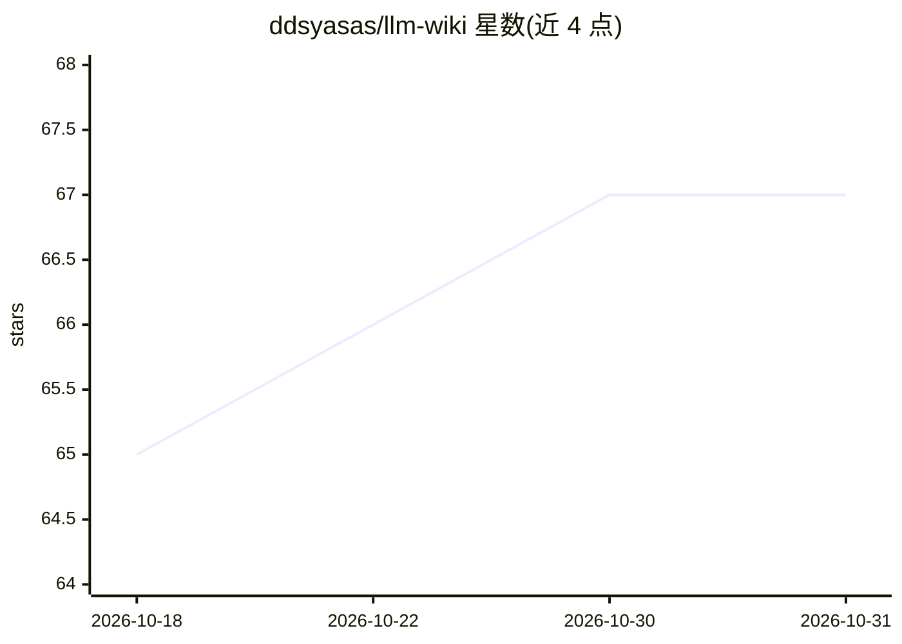

# ddsyasas/llm-wiki

⭐ 67 · TypeScript · MIT · 推送 2026-06-04 · [GitHub](https://github.com/ddsyasas/llm-wiki) · [官网](https://llmwiki.cc) · 个人维护

**由 LLM agent 维护的个人维基知识库：投喂资料自动生成互链笔记**

Karpathy LLM Wiki 模式的从零实现：用户投喂文章、论文、PDF、URL 或笔记，agent 执行 ingest/query/lint 三类操作，把资料编译成互链的纯 markdown 维基本地保存，每次摄入是对整个维基的重构而非追加。提供 3D 知识图谱、双向来源溯源、页面历史备份与按操作槽位（ingest/query/chat/lint/vision）选择模型。LLM 供应商二选一：OpenRouter 云端 BYOK 或本地 Ollama，可混合配置。通过 npm CLI 安装，也可从源码运行，另有托管版 llmwiki.cc（付费候补）。

## 筛选速览

| 维度 | 判定 | 备注 |
|---|---|---|
| AI 角色 | `ai-native` | 本体是模型或模型工具 |
| 许可风险 | `permissive` | MIT |
| 部署形态 | `desktop` | 安装包/桌面程序 |
| 模型依赖 | local-ok | 支持本地模型 |
| 硬件要求 | — | 无带数字的原话,不猜 |
| 安装摩擦 | `low` | 无编译、无系统依赖或容器化 |
| 成熟度 | — | 结构信号不足 |

## 能力要点

- ingest/query/lint 三操作：摄入即全维基重构，lint 提供一键修复
- 输出为纯 markdown，删除应用后可直接在 Obsidian/VS Code 中继续使用
- 五个模型槽位可按操作分别选择 OpenRouter 或本地 Ollama
- 双向来源溯源、页面历史备份与每步操作前的成本预估

## 适用场景

- 把论文、文章和 PDF 逐步积累成可导航、有引用的个人知识库
- 用本地 Ollama 在自己机器上私密地维护维基
- 对已有维基做健康检查（断链、矛盾、过时内容）并一键修复

## 场景标签

`知识库管理` `文档问答` · 领域:知识与检索

## 证据(README 行号)

> L5:  A personal Wikipedia an LLM maintains for you.
> L84: - **Ingest** — Drop a source (text / file / URL / PDF / image) → the LLM reads it + your existing wiki, writes new 
> L85: - **Query** — One-shot Q&A against the whole wiki with cited pages. "Save as wiki page" promotes useful answers int

## 星数曲线

2026-10-18 65 → 2026-10-31 67（+2）

---
*卡片 v1 · prompt 1.4 · 生成 2026-10-24 · 置信度 mid · 依据 README sha `64566b37c0fc` · [字段定义](../../DATASET.md)*
