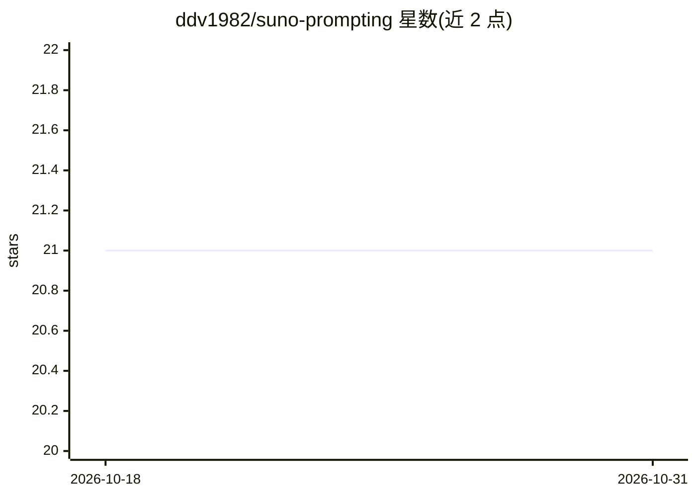

# ddv1982/suno-prompting

⭐ 21 · TypeScript · MIT · 推送 2026-04-02 · [GitHub](https://github.com/ddv1982/suno-prompting) · 个人维护

**把口语化歌曲创意转成 Suno V5 提示词的桌面应用**

基于 Bun/Electrobun 的桌面应用，将英文歌曲描述生成为 Suno V5 可用的结构化提示词（Genre/BPM/Mood/Instruments 字段），提供 Full Prompt、Quick Vibes、Creative Boost 三种模式及 Max Mode、Story Mode、歌词生成等选项。AI 生成可走 Ollama 本地模型（Gemma 3 4B，离线无 API key）或 Groq/OpenAI/Anthropic 云端；无 LLM 时降级为关键词匹配的确定性输出。体裁检测采用关键词→拼写纠正→LLM 三级机制。通过 bun install/start 运行，支持三平台构建。

## 筛选速览

| 维度 | 判定 | 备注 |
|---|---|---|
| AI 角色 | `ai-native` | 本体是模型或模型工具 |
| 许可风险 | `permissive` | MIT |
| 部署形态 | `None` |  |
| 模型依赖 | local-ok | 支持本地模型 |
| 硬件要求 | — | 无带数字的原话,不猜 |
| 安装摩擦 | `low` | 无编译、无系统依赖或容器化 |
| 成熟度 | — | 结构信号不足 |

## 能力要点

- 本地 Ollama（Gemma 3 4B）离线生成，无需 API key
- 三种生成模式 + Max Mode / Story Mode / 歌词生成
- 关键词→拼写纠正→LLM 三级体裁检测，含确定性降级
- 60 个体裁、约 900+ Suno V5 官方风格、20 类心情选择器

## 适用场景

- 把一句歌的点子变成格式合规的 Suno V5 提示词
- 完全离线本地生成歌曲提示词
- 探索实验性流派组合与地域特色乐器

## 场景标签

`提示工程` · 领域:Agent 开发

## 证据(README 行号)

> L3: Desktop app that turns plain-English song ideas into **Suno V5-ready** prompts with genre/mood/instrument guidance a
> L42: |**Ollama (Local)**|Gemma 3 4B|ollama.ai/download - **No API key required**|
> L91: - **Local LLM support**: 100% offline AI generation with Ollama (no API keys, fully private)

## 星数曲线

2026-10-18 21 → 2026-10-31 21（+0）

---
*卡片 v1 · prompt 1.4 · 生成 2026-10-28 · 置信度 high · 依据 README sha `e673f98f1785` · [字段定义](../../DATASET.md)*
