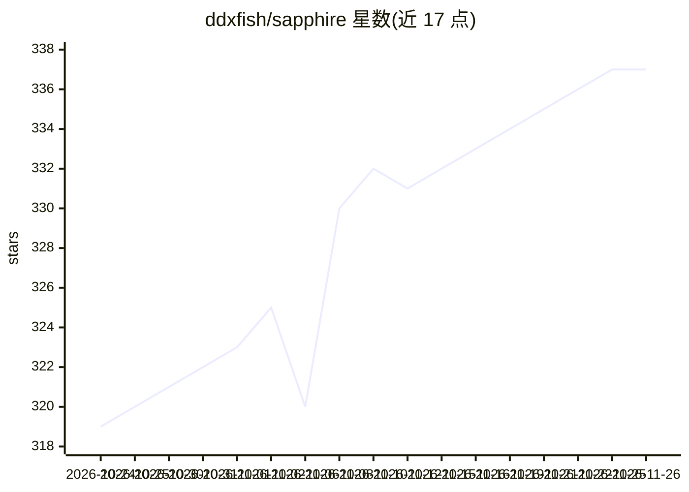

# ddxfish/sapphire

⭐ 337 · Python · AGPL-3.0 · 推送 2026-11-25 · [GitHub](https://github.com/ddxfish/sapphire) · [官网](https://sapphireblue.dev/) · 个人维护

**自托管语音 AI 伴侣框架：构建有长期记忆的个性化智能代理**

以 Python 为主体的 agentic 框架，用户可构建带人格、语音（唤醒词/STT/TTS）与长期记忆（向量检索、Mind Palace 图谱）的 AI 伴侣。集成智能家居、Discord/Telegram/邮件、Google Calendar、SSH、MCP 服务端与客户端等工具，支持心跳调度、目标系统、夜间 Librarian 整理记忆，并提供插件商店与让 AI 自行编写工具的 Tool Maker。需 16GB+ 内存、Python 3.11（conda）；Mac 仅支持 Docker，本地 LLM 需更多内存。

## 筛选速览

| 维度 | 判定 | 备注 |
|---|---|---|
| AI 角色 | `ai-native` | 本体是模型或模型工具 |
| 许可风险 | `viral` | AGPL-3.0 |
| 部署形态 | `desktop` | 安装包/桌面程序 |
| 模型依赖 | local-ok | 支持本地模型 |
| 硬件要求 | — | 无带数字的原话,不猜 |
| 安装摩擦 | `low` | 无编译、无系统依赖或容器化 |
| 成熟度 | `idea` | |

## 能力要点

- 人格系统含 12 内置人格，AI 可自改提示词与情绪片段
- 分层记忆引擎（Mind Palace）与 100K+ 条语义向量检索
- 本地 Kokoro TTS/STT 语音链路，可切换 ElevenLabs；Twilio 真实电话接入
- MCP 服务端/客户端与插件商店生态

## 适用场景

- 自托管一个有长期记忆的家庭 AI 伴侣并联动 Home Assistant
- 给 AI 配置手机号让她接打电话和收发消息
- 用 ESP32/Pi 卫星设备搭建分布式语音终端
- 让 AI 夜间自主整理记忆并推进目标任务

## 场景标签

`AI 助手` `语音 Agent` `Agent 记忆` · 领域:Agent 开发

## 证据(README 行号)

> L3: Sapphire is an agentic framework with voice that is customizable. Build your own AI persona that is a true smart hom
> L25: Hey I'm Chris, a solo dev with a burning passion for this project. Sapphire is an agentic framework exploring perso
> L81: - **Cloud LLM Support** (optional) - Claude, GPT, Gemini, Fireworks, or any OpenAI/Anthropic-compatible endpoint (O

## 星数曲线

2026-10-24 319 → 2026-11-26 337（+18）

---
*卡片 v1 · prompt 1.4 · 生成 2026-11-25 · 置信度 mid · 依据 README sha `9e3a003c5136` · [字段定义](../../DATASET.md)*
