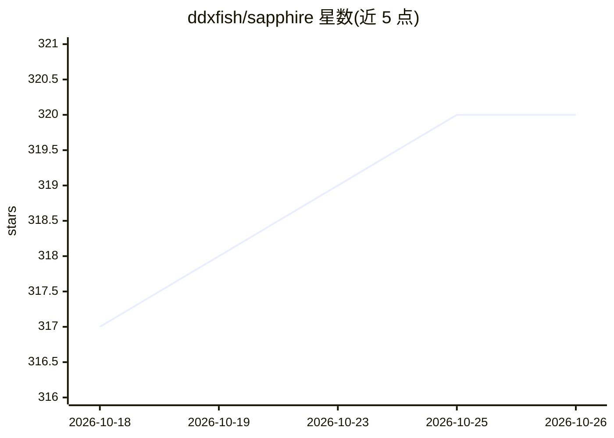

# ddxfish/sapphire

⭐ 320 · Python · AGPL-3.0 · 推送 2026-10-24 · [GitHub](https://github.com/ddxfish/sapphire) · [官网](https://sapphireblue.dev/) · 个人维护

**自托管的语音 AI 伴侣/agent 框架，可定制人格与长期记忆**

面向个人用户的开源自托管 agentic 框架：提供 12 种内置人格（捆绑提示词、语音、工具与模型）、唤醒词/STT/TTS 语音对话、长期记忆（语义向量检索、分层记忆引擎、夜间图书管理员整理）、目标与心跳调度、后台 agent。集成覆盖 Discord、Telegram、邮件、Twilio 电话、Home Assistant、SSH、比特币、MCP 等，AI 可在运行时自写并安装新工具。本地优先，支持 Ollama/LM Studio 作为本地端点，亦可接 Claude/GPT/Gemini。README 明确警告其可执行 shell 命令并自主运行，需谨慎配置工具集。安装途径为 Sapphire Launcher（Windows .exe / Linux .AppImage）、conda+git 源码运行或 Docker。

## 筛选速览

| 维度 | 判定 | 备注 |
|---|---|---|
| AI 角色 | `ai-native` | 本体是模型或模型工具 |
| 许可风险 | `viral` | AGPL-3.0 |
| 部署形态 | `desktop` | 安装包/桌面程序 |
| 模型依赖 | local-ok | 支持本地模型 |
| 硬件要求 | — | 无带数字的原话,不猜 |
| 安装摩擦 | `low` | 无编译、无系统依赖或容器化 |
| 成熟度 | `idea` | |

## 能力要点

- 12 种内置人格，AI 可编辑自身提示词并在对话中切换情绪/人格片段
- 长期记忆体系：语义向量检索、分层记忆引擎与夜间自动整理
- 运行时工具自造（Tool Maker）：AI 编写、验证并安装新工具
- 集成 Discord/Telegram/邮件/Twilio 电话/Home Assistant/MCP 等，附插件商店

## 适用场景

- 搭建住在家里的语音 AI 伴侣，唤醒词免提对话并记住日常
- 通过电话、Discord、Telegram 等渠道与自己的 AI 对话
- 作为智能家居中枢控制灯光、温控与通知
- 开发者通过插件系统扩展工具并发布到插件商店

## 场景标签

`语音 Agent` `Agent 记忆` · 领域:Agent 开发

## 证据(README 行号)

> L3: Sapphire is an agentic framework with voice that is customizable. Build your own AI persona that is a true smart hom
> L25: Hey I'm Chris, a solo dev with a burning passion for this project. Sapphire is an agentic framework exploring perso
> L74: - **Cloud LLM Support** (optional) - Claude, GPT, Gemini, Fireworks, or any OpenAI/Anthropic-compatible endpoint (O

## 星数曲线

2026-10-18 317 → 2026-10-26 320（+3）

---
*卡片 v1 · prompt 1.4 · 生成 2026-10-21 · 置信度 mid · 依据 README sha `e627feb3c849` · [字段定义](../../DATASET.md)*
