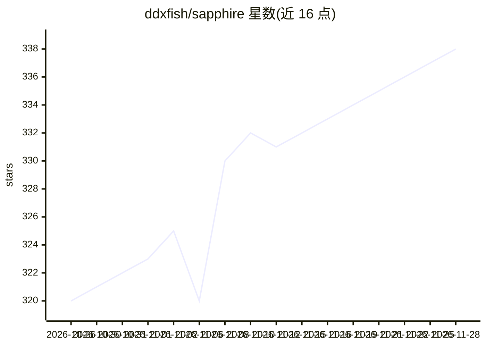

# ddxfish/sapphire

⭐ 338 · Python · AGPL-3.0 · 推送 2026-11-26 · [GitHub](https://github.com/ddxfish/sapphire) · [官网](https://sapphireblue.dev/) · 个人维护

**自托管的语音 AI 伴侣代理框架，个人定制 AI 人格**

Sapphire 是一个自托管的有声代理框架，用户可构建自己的 AI 人格。内置 12 种人格组合（提示词/语音/工具/模型）、唤醒词、STT/TTS 流式语音对话；记忆层采用分层图结构（Mind Palace）支持 10 万+ 条语义向量检索；提供目标系统、心跳调度、后台 Agent 与守护进程。集成 Home Assistant、Twilio 电话、Discord/Telegram/邮件、MCP 服务端与客户端等。AI 可在运行时编写并安装自己的工具。本地优先运行，可选接入云端 LLM。需 16GB+ 内存，macOS 仅支持 Docker 部署。

## 筛选速览

| 维度 | 判定 | 备注 |
|---|---|---|
| AI 角色 | `ai-native` | 本体是模型或模型工具 |
| 许可风险 | `viral` | AGPL-3.0 |
| 部署形态 | `desktop` | 安装包/桌面程序 |
| 模型依赖 | local-ok | 支持本地模型 |
| 硬件要求 | — | 无带数字的原话,不猜 |
| 安装摩擦 | `low` | 无编译、无系统依赖或容器化 |
| 成熟度 | — | 结构信号不足 |

## 能力要点

- 分层记忆引擎（Mind Palace）：记忆/自我/实体/库/目标连通图，10 万+ 条语义向量检索
- AI 运行时自写、验证并安装新工具（Tool Maker）
- 语音链路完整：唤醒词、STT/TTS、流式语音、可打断的免提交谈
- 集成 Home Assistant 智能家居、Twilio 真实电话号码接听与外呼

## 适用场景

- 搭建记住个人习惯的智能家居语音助手，早晨唤醒服务
- 通过 Twilio 电话号码让 AI 接听来电并与白名单联系人通话
- 便携式语音研究/工作伴侣，联网搜索并整理知识库
- 多人格群聊、后台 Agent 并行处理任务

## 场景标签

`语音 Agent` `AI 助手` · 领域:对话与助手

## 证据(README 行号)

> L3: Sapphire is an agentic framework with voice that is customizable. Build your own AI persona that is a true smart hom
> L25: Hey I'm Chris, a solo dev with a burning passion for this project. Sapphire is an agentic framework exploring perso
> L38: - **Memory** - MEMORY.md Semantic vector search across 100K+ labeled entries.

## 星数曲线

2026-10-26 320 → 2026-11-28 338（+18）

---
*卡片 v1 · prompt 1.4 · 生成 2026-11-26 · 置信度 high · 依据 README sha `97ea62858b2a` · [字段定义](../../DATASET.md)*
