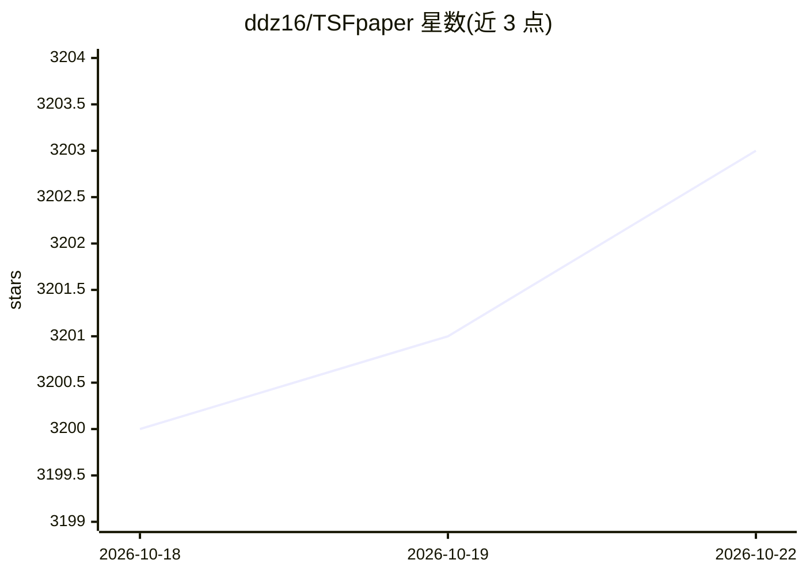

# ddz16/TSFpaper

⭐ 3,204 · 推送 2026-08-14 · [GitHub](https://github.com/ddz16/TSFpaper) · 个人维护 · 中文 README

**时间序列/时空预测论文阅读清单（400+ 篇，按模型类型分类）**

收录 400+ 篇时间序列预测（TSF）与时空预测（STF）论文的阅读清单，按模型类型分类（Transformer、RNN、TCN、SSM、Diffusion、LLM、KAN、多模态、基础模型等），并含 Survey & Benchmark 汇总表。每条记录日期、方法、预测类型（单变量/多变量/时空/不规则时间序列）、会议、论文标题与中文解读及代码链接。条目以表格组织，接受 PR 与 issue 补充，部分论文标注 🌟（个人推荐）与 🔥（高引用）。README 同时给出单变量/多变量/时空预测的形式化定义与区分标准说明。

## 筛选速览

| 维度 | 判定 | 备注 |
|---|---|---|
| AI 角色 | `ai-knowledge` | 知识聚合/清单类 |
| 许可风险 | `none` | — |
| 部署形态 | `None` |  |
| 模型依赖 | — | README 未给出锁定关系 |
| 硬件要求 | — | 无带数字的原话,不猜 |
| 安装摩擦 | `low` | 无编译、无系统依赖或容器化 |
| 成熟度 | — | 结构信号不足 |

## 能力要点

- 400+ 篇 TSF/STF 论文按模型类型分类组织
- 条目含会议、中文解读与代码链接
- 覆盖 LLM+TS、Mamba/SSM、KAN、多模态等新增类别
- 对单变量/多变量/时空预测给出分类判定标准说明

## 适用场景

- 查找时间序列预测领域的论文与代码入口
- 按模型架构类型检索特定方法的代表作
- 了解 TSF/STF 领域综述与基准测试工作分布

## 场景标签

`精选清单` · 领域:学习与行业

## 证据(README 行号)

> L6: This repository contains a reading list of papers (**400+ papers !!!**) on **Time Series Forecasting/Prediction (TSF
> L40: Date|Method|Conference|Paper Title and Paper Interpretation (In Chinese)|Code

## 星数曲线

2026-10-18 3,200 → 2026-10-22 3,203（+3）

---
*卡片 v1 · prompt 1.4 · 生成 2026-10-21 · 置信度 high · 依据 README sha `f4cb50d39fc2` · [字段定义](../../DATASET.md)*
