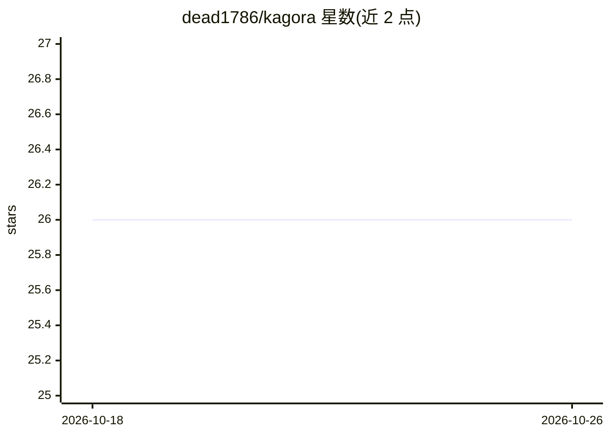

# dead1786/kagora

⭐ 26 · TypeScript · MIT · 推送 2026-10-20 · [GitHub](https://github.com/dead1786/kagora) · 个人维护 · 中文 README

**统一管理多个 AI agent 的终端平台：终端、群聊、定时自动化**

基于 Electron/TypeScript 的桌面应用，为每个 AI agent 分配独立的 PTY 真实终端，agent 之间及与用户之间可通过群聊/私聊通信，支持按间隔/日/周/月的定时任务调度。默认在 7777 端口暴露 HTTP API，可从手机或集成 Telegram/LINE 等外部服务，提供 token 鉴权的管理员模式、agent 启动记忆恢复与插件系统（plugin.json + JS 入口，可注册 webhook、注入终端、订阅事件）。需 Node 20+，Windows 下需 VS Build Tools 与 Python 3 编译 node-pty。

## 筛选速览

| 维度 | 判定 | 备注 |
|---|---|---|
| AI 角色 | `ai-ecosystem` | LLM/agent 周边工具 |
| 许可风险 | `permissive` | MIT |
| 部署形态 | `library` | 以包/库形式分发 |
| 模型依赖 | — | README 未给出锁定关系 |
| 硬件要求 | — | 无带数字的原话,不猜 |
| 安装摩擦 | `medium` | 含编译或系统依赖之一 |
| 成熟度 | — | 结构信号不足 |

## 能力要点

- 每个 agent 独立 PTY 终端（node-pty）
- agent 间群聊/私聊与定时自动化调度
- 端口 7777 HTTP API（发消息、注入终端命令、管理自动化任务）
- 插件系统：webhook 注册、终端控制、事件订阅

## 适用场景

- 在一个窗口中集中运行和操控多个 AI agent 终端
- 让 agent 按计划定时执行自动化任务
- 通过 HTTP API 从手机或 Telegram/LINE 远程驱动 agent

## 场景标签

`多智能体` `工作流自动化` · 领域:Agent 开发

## 证据(README 行号)

> L2:  One app to manage all your AI agents. Terminal, chat, automation — unified.
> L12: Each agent gets its own real terminal. They talk to each other. They run on schedules. You control them all from on

## 星数曲线

2026-10-18 26 → 2026-10-26 26（+0）

---
*卡片 v1 · prompt 1.4 · 生成 2026-10-26 · 置信度 mid · 依据 README sha `018908fd4403` · [字段定义](../../DATASET.md)*
