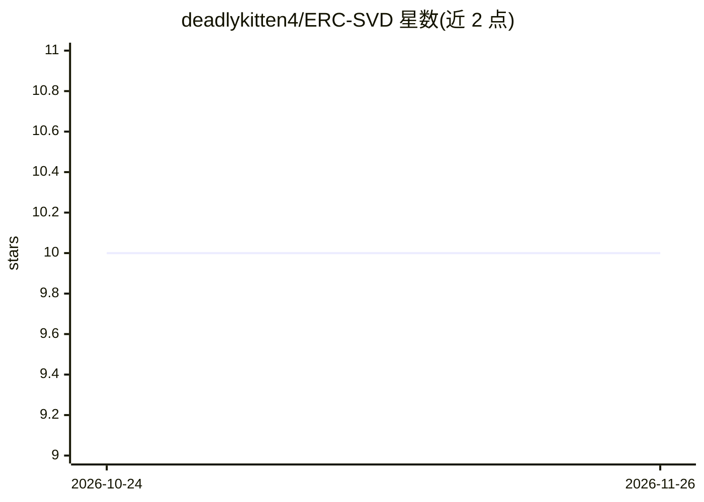

# deadlykitten4/ERC-SVD

⭐ 10 · Python · MIT · 推送 2026-08-28 · [GitHub](https://github.com/deadlykitten4/ERC-SVD) · [官网](https://deadlykitten4.github.io/ERC-SVD/) · 组织维护

**面向研究者的 LLM SVD 低秩压缩与评测代码**

CPAL 2026 论文 ERC-SVD 的官方实现，提供基于误差控制的 SVD 大语言模型压缩流程：两步执行压缩脚本生成压缩后模型（.pt），随后进行 Perplexity 与 zero-shot accuracy 评测。运行方式为 conda 创建 Python 3.10 环境并 pip 安装 requirements.txt，示例以 llama-2-7b-hf 与 wikitext2 数据集为输入。README 未提供安装包或 Docker 途径，致谢 ASVD 与 SVD-LLM，并给出 BibTeX 引用条目。

## 筛选速览

| 维度 | 判定 | 备注 |
|---|---|---|
| AI 角色 | `ai-ecosystem` | LLM/agent 周边工具 |
| 许可风险 | `permissive` | MIT |
| 部署形态 | `library` | 以包/库形式分发 |
| 模型依赖 | — | README 未给出锁定关系 |
| 硬件要求 | — | 无带数字的原话,不猜 |
| 安装摩擦 | `low` | 无编译、无系统依赖或容器化 |
| 成熟度 | — | 结构信号不足 |

## 能力要点

- 两步式 SVD 压缩流程（loss 分析 + 模型保存）
- Perplexity 与 zero-shot accuracy 评测脚本
- 可配置压缩比、whitening 采样数、序列长度等参数

## 适用场景

- 对本地 Llama 类模型执行 SVD 低秩压缩实验
- 复现论文中的压缩比与困惑度评测结果
- 作为模型压缩研究的代码基础进行修改

## 场景标签

`模型量化` `模型评测` · 领域:评测与运维

## 证据(README 行号)

> L19: ### 2. Perform SVD compression
> L23: python ERC-SVD_compression.py --model /yout/path/to/llama-2-7b-hf/ --step 0 --ratio 0.2 --whitening_nsamples 256 --

## 星数曲线

2026-10-24 10 → 2026-11-26 10（+0）

---
*卡片 v1 · prompt 1.4 · 生成 2026-11-19 · 置信度 high · 依据 README sha `69cde97b10da` · [字段定义](../../DATASET.md)*
