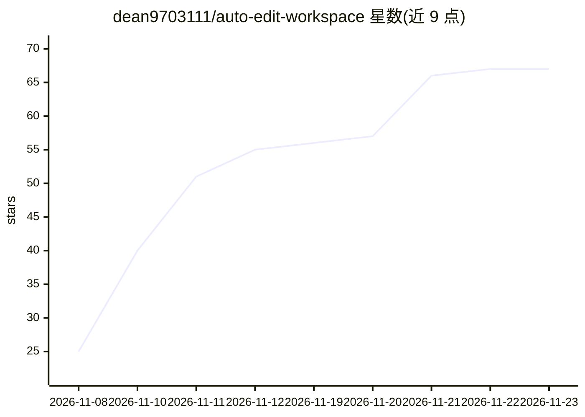

# dean9703111/auto-edit-workspace

⭐ 67 · JavaScript · MIT · 推送 2026-11-22 · [GitHub](https://github.com/dean9703111/auto-edit-workspace) · [官网](https://deanlin.net/auto-edit-workspace/) · 个人维护 · 中文 README

**给创作者的 AI 自动剪辑工作区：白话指令剪出讲解影片**

面向 talking-head 讲解影片的开源剪辑工作区，基于 HyperFrames 构建：用户放入影片、旁白、屏幕录影与图片，用自己的 AI Agent（Claude Code、Codex、MiniMax Code、Cursor）以白话指令驱动「剪干净」「做出完成影片」等流程——自动剪 NG、按讲稿上字幕、加信息卡与情境动画、配音效，输出 final.mp4 或剪映可用素材。分工上 Agent 负责判断（NG、情境、版面），程序负责计算（词级时间、断句、响度）；规则、模板、音效对照均为纯文本档可改。流程设六个停点供用户在网页界面确认修改；转档、字幕、render 均在本机执行。

## 筛选速览

| 维度 | 判定 | 备注 |
|---|---|---|
| AI 角色 | `ai-native` | 本体是模型或模型工具 |
| 许可风险 | `permissive` | MIT |
| 部署形态 | `library` | 以包/库形式分发 |
| 模型依赖 | — | README 未给出锁定关系 |
| 硬件要求 | — | 无带数字的原话,不猜 |
| 安装摩擦 | `medium` | 含编译或系统依赖之一 |
| 成熟度 | — | 结构信号不足 |

## 能力要点

- 白话指令驱动：剪 NG、上字幕、配情境动画与音效，输出 final.mp4（1080p/4K）
- 支持 Claude Code、Codex、MiniMax Code、Cursor 等 Agent，守则写于 AGENTS.md、流程拆成 9 支 Skill
- 六种停点的网页确认界面：剪辑清单、构图、分镜表、剪辑台、背景预览、完成影片预览
- 可输出剪映素材（主轨＋透明 MOV＋SRT），风格/模板/偏好均为纯文本档、跨集沿用

## 适用场景

- 我想用一句话让 AI 把讲错重讲的片段剪掉、按讲稿上好字幕
- 我想不写任何格式，在分镜表网页上调整每段画面后让 AI 继续做
- 我想把横式长片裁成直式短片，或拆出剪映素材继续精修

## 场景标签

`图像视频处理` · 领域:感知与多模态

## 证据(README 行号)

> L20: 準備好影片、聲音、圖片這些素材，**用白話文跟 AI 說「剪乾淨」「做出完成影片」**，它就幫你剪掉講錯的地方、上字幕、加字卡和動畫、配音效。每一步都會停下來給你看；不滿意的地方，說一句話、在剪輯台自己拖，或勾在修改單上交給 AI
> L26: > **English** — An open-source AI video editing workspace for talking-head videos. Drop in your footage, voice-over
> L195: - **AI Agent 負責判斷**：哪一句是 NG、這段講解在講什麼情境、該用哪個版面和動畫、卡片上寫什麼。

## 星数曲线

2026-11-08 25 → 2026-11-23 67（+42）

---
*卡片 v1 · prompt 1.4 · 生成 2026-11-18 · 置信度 mid · 依据 README sha `52be29ddbe75` · [字段定义](../../DATASET.md)*
