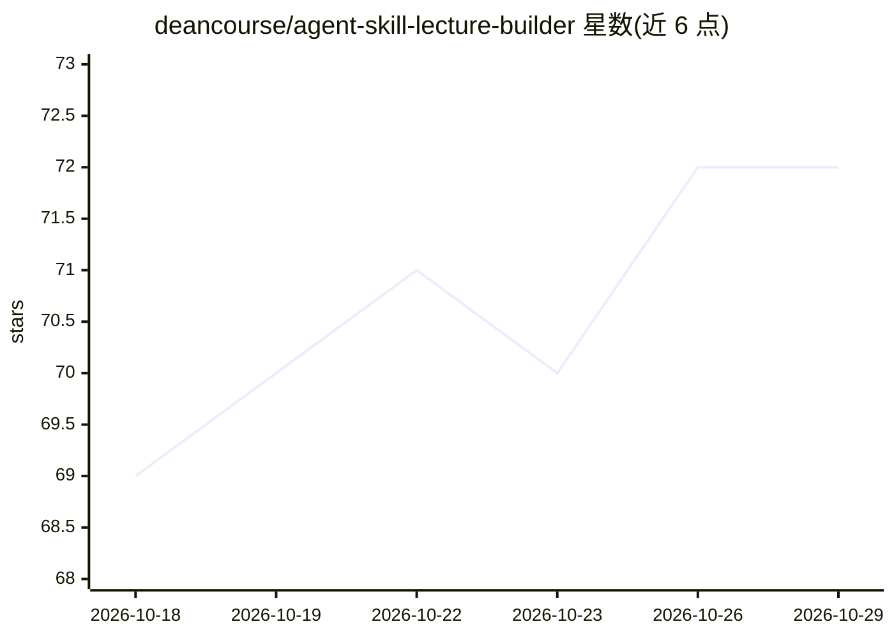

# deancourse/agent-skill-lecture-builder

⭐ 72 · HTML · 推送 2026-04-12 · [GitHub](https://github.com/deancourse/agent-skill-lecture-builder) · [官网](https://youtu.be/0pZri5f_tfk) · 个人维护 · 中文 README

**講者/教師用的 Agent Skill：把主題或 Markdown 講稿生成單一 HTML 課程頁面**

以 Agent Skills 封裝的課程頁面生成工具：使用者提供主題或現有講稿，由 AI 觸發 course-page-generator Skill 依序生成 content.md、config.yaml、構建 index.html、產生 OG 縮圖並啟動本地預覽。講稿採用約定的 Markdown 擴充語法（章節、卡片、流程、圖文並排、YouTube 嵌入、Bonus 彈窗等），設定採兩層 YAML deep merge（全域+課程）。提供 build/dev/generate-og 三個 Node 腳本，dev 模式監看檔案自動重建。附 YouTube 教學影片，面向使用 Codex 等 agent 的講者。

## 筛选速览

| 维度 | 判定 | 备注 |
|---|---|---|
| AI 角色 | `ai-native` | 本体是模型或模型工具 |
| 许可风险 | `none` | — |
| 部署形态 | `library` | 以包/库形式分发 |
| 模型依赖 | — | README 未给出锁定关系 |
| 硬件要求 | — | 无带数字的原话,不猜 |
| 安装摩擦 | `low` | 无编译、无系统依赖或容器化 |
| 成熟度 | — | 结构信号不足 |

## 能力要点

- 主題或講稿輸入，AI 觸發 Skill 生成完整課程頁面
- 兩層 YAML 設定（global/course）deep merge，課程層只需寫覆蓋欄位
- 擴充 Markdown 語法：卡片、流程、圖文並排、YouTube 嵌入、Bonus 彈窗
- build/dev/generate-og Node 腳本，dev 監看自動重建與瀏覽器刷新

## 适用场景

- 把現有講稿或筆記轉成可部署的課程網頁
- 只給主題，讓 AI 從零生成講義內容並建置頁面
- 用 Markdown 模板長期維護講義，一鍵重建上線

## 场景标签

`AI 写作` · 领域:内容生成

## 证据(README 行号)

> L25: 提供主題 or Markdown 講稿，透過 Agent Skills 單一 HTML 課程頁面。
> L38: 在 AI 對話窗輸入「幫我生成課程頁面」這類指令，AI 會自動觸發 `course-page-generator` Skill 完成所有步驟。
> L48: AI 會依序：生成 `content.md` + `config.yaml` → build `index.html` → 產生 OG 縮圖 → 啟動本地預覽

## 星数曲线

2026-10-18 69 → 2026-10-29 72（+3）

---
*卡片 v1 · prompt 1.4 · 生成 2026-10-24 · 置信度 high · 依据 README sha `6aedf72de250` · [字段定义](../../DATASET.md)*
