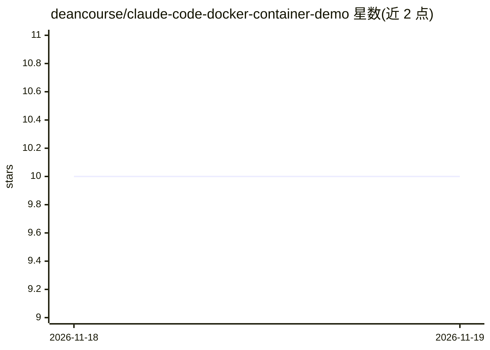

# deancourse/claude-code-docker-container-demo

⭐ — · [GitHub]() · 个人维护 · 中文 README

**在防火墙白名单沙箱容器中运行 Claude Code 的模板**

改编自 Anthropic 官方 .devcontainer 的沙箱模板：以 node:20 为基础镜像构建 Dev Container，通过 init-firewall.sh 以 iptables/ipset 将容器出站流量默认 DROP、仅放行 GitHub、npm registry、api.anthropic.com 等白名单域，使 AI Agent 在隔離环境中读写代码、执行命令，降低数据外泄与误操作风险。需 Docker 与支持 Dev Containers 扩展的 IDE，容器需 NET_ADMIN/NET_RAW 权限以设置防火墙；代码经 bind mount 挂载到 /workspace。

## 筛选速览

| 维度 | 判定 | 备注 |
|---|---|---|
| AI 角色 | `ai-ecosystem` | LLM/agent 周边工具 |
| 许可风险 | `permissive` | — |
| 部署形态 | `self-host` | docker 或自建部署 |
| 模型依赖 | locked-api |  |
| 硬件要求 | — | 无带数字的原话,不猜 |
| 安装摩擦 | `low` | 无编译、无系统依赖或容器化 |
| 成熟度 | — | 结构信号不足 |

## 能力要点

- iptables/ipset 防火墙白名单，出站默认 DROP 仅放行少量域
- 脚本结尾自验证防火墙生效（可连 GitHub、不可连 example.com）
- named volume 保留 Claude 登入状态与命令历史
- 支持通过白名单追加域、在容器内重跑或重建容器

## 适用场景

- 在受限网络下让 Claude Code 安全操作我的项目代码
- 防止 Agent 执行期间向未知域名外传数据
- 为团队提供统一的沙箱化开发容器配置

## 场景标签

`编码 Agent` · 领域:编码与开发

## 证据(README 行号)

> L11: 在一個**網路受限的 Docker 容器**裡執行 Claude Code，讓 AI Agent 可以在隔離環境中讀寫程式碼、執行指令，同時透過防火牆把對外連線限制在少數白名單網域，降低資料外洩與誤操作的風險。
> L48: - **Claude Code CLI**：`@anthropic-ai/claude-code`（版本由 `devcontainer.json` 的 `CLAUDE_CODE_VERSION` 控制，預設 `latest`）

## 星数曲线

2026-11-18 10 → 2026-11-19 10（+0）

---
*卡片 v1 · prompt 1.4 · 生成 2026-11-19 · 置信度 mid · 依据 README sha `9dab2cc9e829` · [字段定义](../../DATASET.md)*
