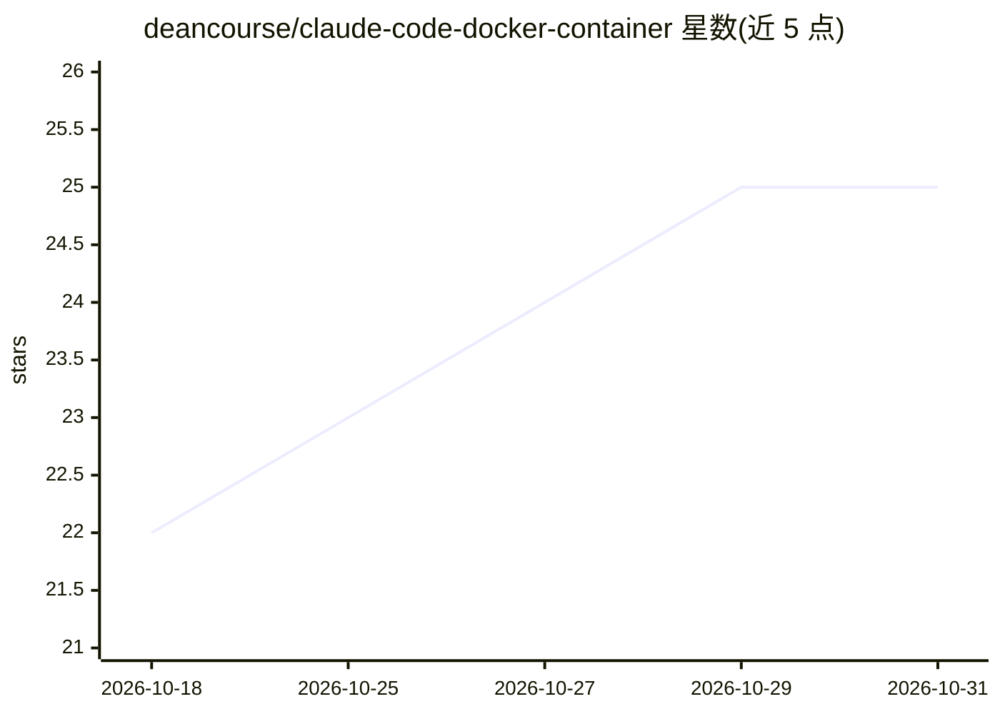

# deancourse/claude-code-docker-container

⭐ 25 · Shell · MIT · 推送 2026-09-12 · [GitHub](https://github.com/deancourse/claude-code-docker-container) · [官网](https://www.youtube.com/watch?v=BPdyiaC-3Lw) · 个人维护 · 中文 README

**在 Docker 容器中隔离执行 Claude Code 并以防火墙白名单限制其对外连线**

改自 Anthropic 官方 .devcontainer 参考实现的开发容器项目：以 node:24 为基底映像预装 Claude Code CLI 与常用开发工具，通过 init-firewall.sh 设定 iptables/ipset，将 OUTPUT 默认政策设为 DROP，仅放行 GitHub、npm、Anthropic API 等白名单网域，以降低 AI Agent 读写程式码与执行指令时的资料外泄风险。使用者以 VS Code、Cursor 或 Antigravity 开启资料夹并 Reopen in Container 即可使用；预装 SKILL.md 格式的 Agent Skills 并以版控管理。限制：容器需要 NET_ADMIN/NET_RAW 权限，预设无法存取 PyPI 与 apt 套件库，需自行加入白名单。

## 筛选速览

| 维度 | 判定 | 备注 |
|---|---|---|
| AI 角色 | `ai-ecosystem` | LLM/agent 周边工具 |
| 许可风险 | `permissive` | MIT |
| 部署形态 | `self-host` | docker 或自建部署 |
| 模型依赖 | locked-api |  |
| 硬件要求 | — | 无带数字的原话,不猜 |
| 安装摩擦 | `low` | 无编译、无系统依赖或容器化 |
| 成熟度 | — | 结构信号不足 |

## 能力要点

- iptables/ipset 防火墙白名单：OUTPUT 预设 DROP，仅放行 GitHub/npm/Anthropic API 等网域
- 以 node:24 为基底预装 Claude Code CLI、gh、fzf、jq 等开发工具
- named volume 保留 Claude 设定与登录状态，容器重建后不遗失
- 以 skills CLI 安装 SKILL.md 知识包并以 skills-lock.json 版控

## 适用场景

- 在网路受限的沙箱中让 Claude Code 自主读写程式码并执行指令
- 防止 AI Agent 将资料外传到白名单之外的网域
- 为团队提供可版控、可复建的 AI coding 环境设定

## 场景标签

 · 领域:开发环境/容器化工具

## 证据(README 行号)

> L6: 在一個**有限制的 Docker 容器**裡執行 Claude Code，讓 AI Agent 可以在隔離環境中讀寫程式碼、執行指令，同時透過防火牆把對外連線限制在少數白名單網域，降低資料外洩與誤操作的風險。
> L72: `init-firewall.sh` 會把 `OUTPUT` 預設政策設為 `DROP`，**只允許**以下白名單網域（其餘一律拒絕）：

## 星数曲线

2026-10-18 22 → 2026-10-31 25（+3）

---
*卡片 v1 · prompt 1.4 · 生成 2026-10-27 · 置信度 mid · 依据 README sha `601e06b330a6` · [字段定义](../../DATASET.md)*
