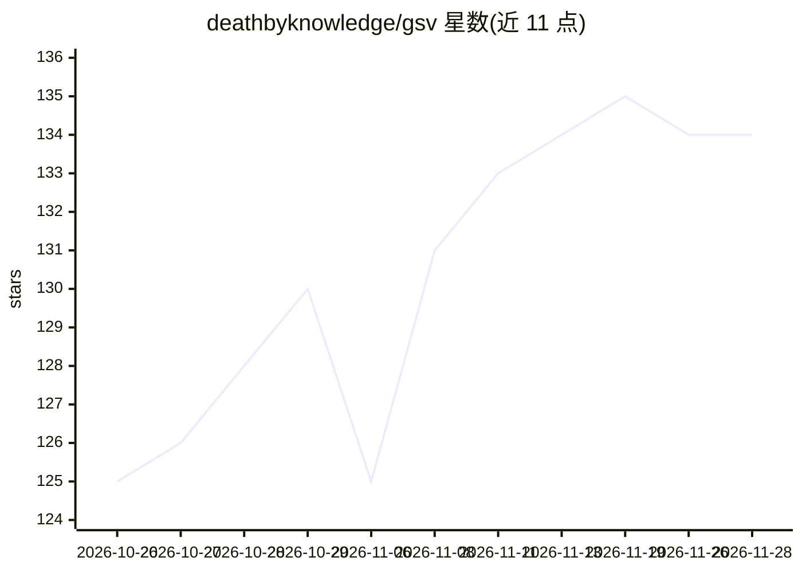

# deathbyknowledge/gsv

⭐ 134 · TypeScript · MIT · 推送 2026-11-27 · [GitHub](https://github.com/deathbyknowledge/gsv) · [官网](https://ship.space) · 个人维护

**开源个人 AI agent 及其自托管运行时，可接入你的设备代办事**

Ship 是开源个人 AI agent，用户通过 web 应用、Desktop、gsv CLI 或消息软件（WhatsApp/Telegram/Slack/Discord/邮件）下达任务，agent 使用用户接入的电脑、浏览器和账户执行工作，跨会话保持状态并在变化时通知。本仓库 GSV 是其运行时：Cloudflare 边缘上的 Gateway 控制面（内核、身份、权限、调度）、持久化 agent 进程、syscall 抽象与部署。自托管需 Cloudflare Workers Paid、域名、Node.js 22+ 与 Rust；模型默认跑在 Workers AI 上。

## 筛选速览

| 维度 | 判定 | 备注 |
|---|---|---|
| AI 角色 | `ai-native` | 本体是模型或模型工具 |
| 许可风险 | `permissive` | MIT |
| 部署形态 | `None` |  |
| 模型依赖 | — | README 未给出锁定关系 |
| 硬件要求 | — | 无带数字的原话,不猜 |
| 安装摩擦 | `low` | 无编译、无系统依赖或容器化 |
| 成熟度 | — | 结构信号不足 |

## 能力要点

- Gateway 控制面 + 持久化 agent 进程 + syscall 能力检查调用
- 八种 agent 工具（Read/Write/Edit/Delete/Search/Shell/CodeMode/Send），集成以能力扩展而非新工具
- 多端接入：web、Desktop、gsv CLI、浏览器扩展及五种消息软件
- 每个 Ship 在 AT Protocol 网络发布公开档案，可选 AT Protocol 主机

## 适用场景

- 让 agent 跟进退款、发邮件等日常事务
- 部署到自己的 Cloudflare 账户运行私人助手
- 通过消息软件随时给 agent 派活并接收通知
- 把自有电脑/浏览器接入为 agent 的工作目标

## 场景标签

`AI 助手` · 领域:对话与助手

## 证据(README 行号)

> L15: Ship is an open-source personal AI agent. You give it things to do from the web
> L20: This repository is **GSV**, the runtime Ship is built on: the control plane,
> L58: `<handle>.example.com`. Models run on your account's Workers AI by default, and

## 星数曲线

2026-10-26 125 → 2026-11-28 134（+9）

---
*卡片 v1 · prompt 1.4 · 生成 2026-11-28 · 置信度 high · 依据 README sha `ef8ec0b56d55` · [字段定义](../../DATASET.md)*
