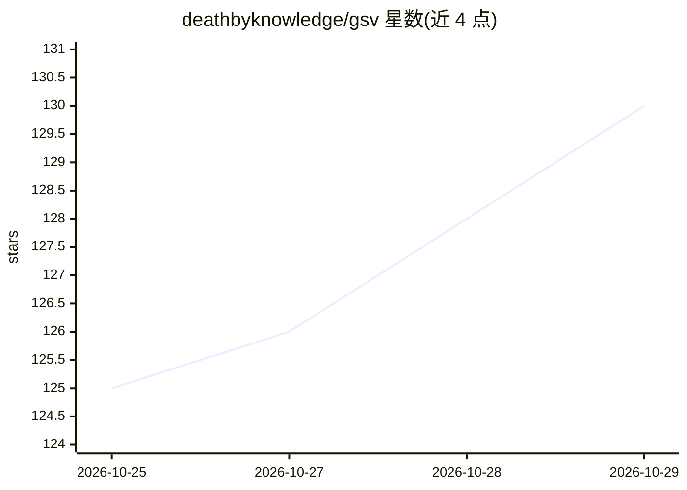

# deathbyknowledge/gsv

⭐ 130 · TypeScript · MIT · 推送 2026-10-28 · [GitHub](https://github.com/deathbyknowledge/gsv) · [官网](https://ship.space) · 组织维护

**部署在自有 Cloudflare 账号上的个人 AI 代理平台**

Ship 是开源的个人 AI 代理系统：在用户自己的 Cloudflare 账号内部署轻量控制平面，把笔记本、服务器、手机与浏览器连成一台机器，代理以持久进程形式在边缘运行，具备记忆、权限与子代理派生能力。用户通过 Web UI、CLI、浏览器扩展及 Discord/Telegram/Slack 适配器与之交互，代理可操作已连接设备的 shell 与文件。限制：需要 Cloudflare 账号与 Workers Paid，模型推理数据会路由至所配置的模型提供商，公开组件含 CodeMode。提供主机安装脚本与源码部署两种方式。

## 筛选速览

| 维度 | 判定 | 备注 |
|---|---|---|
| AI 角色 | `ai-native` | 本体是模型或模型工具 |
| 许可风险 | `permissive` | MIT |
| 部署形态 | `None` |  |
| 模型依赖 | — | README 未给出锁定关系 |
| 硬件要求 | — | 无带数字的原话,不猜 |
| 安装摩擦 | `low` | 无编译、无系统依赖或容器化 |
| 成熟度 | `idea` | |

## 能力要点

- 控制平面部署在用户自己的 Cloudflare 账号，设备仅出站连接无需开放端口
- 代理为持久进程，具备 PIDs、记忆、权限与子代理派生
- 捆绑 Discord/Telegram/Slack 适配器与可驱动真实浏览器的 Web 扩展
- 主机安装程序覆盖 Linux/macOS/Windows 多平台并含原生 Desktop 与本地转录助手

## 适用场景

- 跨自己的多台设备运行同一个个人 AI 代理
- 设备休眠时让代理在边缘继续处理工作
- 通过 Discord/Telegram/Slack 或网页与个人代理对话并派发任务

## 场景标签

`AI 助手` · 领域:对话与助手

## 证据(README 行号)

> L15: **Ship is your personal spaceship.** It stays in orbit while you live your life down here on Earth. Talk to your Sh
> L23: - Run things across all your machines from one agent — kick off a job on your home server while your laptop's shut.
> L27: - Spawn durable agents with their own memory and permissions, that can start sub-agents of their own.

## 星数曲线

2026-10-25 125 → 2026-10-29 130（+5）

---
*卡片 v1 · prompt 1.4 · 生成 2026-10-24 · 置信度 high · 依据 README sha `85dc7fa134bf` · [字段定义](../../DATASET.md)*
