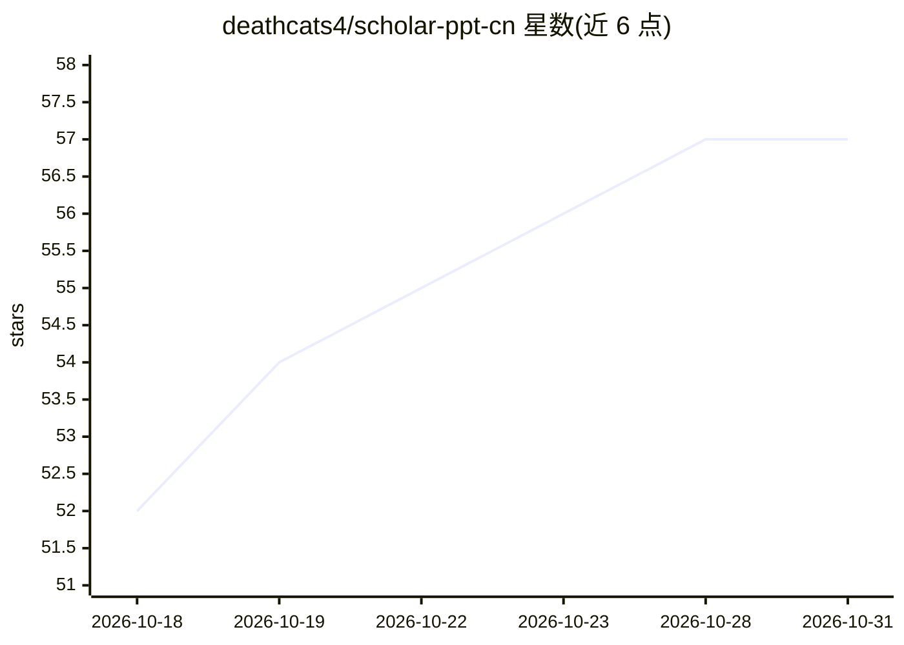

# deathcats4/scholar-ppt-cn

⭐ 57 · Python · MIT · 推送 2026-09-07 · [GitHub](https://github.com/deathcats4/scholar-ppt-cn) · 个人维护 · 中文 README

**给 Codex/ChatGPT 的中文学术 PPT 生成技能包**

一个装入支持 Skills 的 AI 智能体（Codex、ChatGPT 等）的学术 PPT 技能包，面向需要文献汇报、组会 PPT、答辩、研究进展、课程报告的用户。可从论文 PDF、提纲、旧 PPT 或 PPT 截图生成可编辑 PPTX：内置多种叙事框架与中文学术参考模板，支持在已有 PPT 上延续制作、把页面图片重建为原生 PowerPoint 对象、局部/整篇修订，交付前经渲染预览与静态质检。可选本机工具（Python、LibreOffice、poppler、Node.js）缺失时会自动降级。需通过脚本生成运行时目录后放入 Skills 目录使用。

## 筛选速览

| 维度 | 判定 | 备注 |
|---|---|---|
| AI 角色 | `ai-ecosystem` | LLM/agent 周边工具 |
| 许可风险 | `permissive` | MIT |
| 部署形态 | `None` |  |
| 模型依赖 | — | README 未给出锁定关系 |
| 硬件要求 | — | 无带数字的原话,不猜 |
| 安装摩擦 | `low` | 无编译、无系统依赖或容器化 |
| 成熟度 | — | 结构信号不足 |

## 能力要点

- 从论文/资料生成页面文字与结构可编辑的 PPTX
- PPT 截图/PDF 页重建为原生 PowerPoint 对象，科研图可整体保留
- 内置文献汇报、答辩、研究进展等多种叙事框架与中文学术参考模板
- 交付前渲染预览、静态质检、逐页检查，可选本机工具缺失时自动降级

## 适用场景

- 把论文 PDF 做成组会汇报或答辩 PPT
- 在旧 PPT 或自己的模板上换新课题内容继续制作
- 把 PPT 截图或 PDF 页面重建成可编辑的 PPTX
- 对已有 PPT 做批量术语替换、统一字体等修订

## 场景标签

`提示工程` `科研工具` · 领域:Agent 开发

## 证据(README 行号)

> L5: scholar-ppt-cn 是一个装进 AI 助手（Codex、ChatGPT 等支持 Skills 的智能体）的**学术 PPT 技能包**。你负责提供材料和想法，它负责完成从结构规划到成品交付的整套活儿。
> L81: ├── SKILL.md              技能主说明（智能体从这里读取工作流程）

## 星数曲线

2026-10-18 52 → 2026-10-31 57（+5）

---
*卡片 v1 · prompt 1.4 · 生成 2026-10-24 · 置信度 high · 依据 README sha `7b884b0cbdfd` · [字段定义](../../DATASET.md)*
