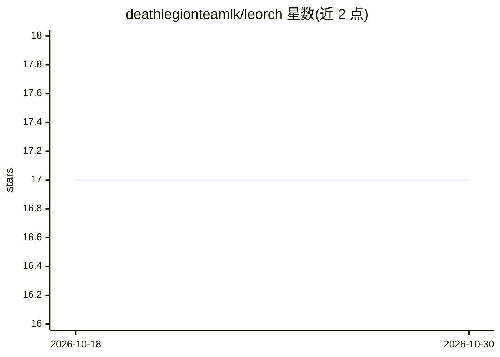

# deathlegionteamlk/leorch

⭐ 17 · Rust · MIT · 推送 2026-07-14 · [GitHub](https://github.com/deathlegionteamlk/leorch) · 组织维护

**用 Rust 从零实现的深度学习框架，供学习底层原理**

Leorch 是用 Rust 从零编写的深度学习框架，不依赖 PyTorch 或 libtorch 绑定，自身实现张量运算（基于 ndarray）、自动微分计算图、NN 层（Linear/Conv2D/BN 等）、损失函数、优化器（SGD/Adam 等）、学习率调度器与 DataLoader。API 设计贴近 PyTorch 以便概念对照，定位为理解深度学习框架内部机制的代码库。CPU 运算通过 rayon 并行，GPU/CUDA 支持在路线图中尚未实现。通过 Cargo.toml 依赖或 git clone 后 cargo build 使用。

## 筛选速览

| 维度 | 判定 | 备注 |
|---|---|---|
| AI 角色 | `ai-native` | 本体是模型或模型工具 |
| 许可风险 | `permissive` | MIT |
| 部署形态 | `None` |  |
| 模型依赖 | — | README 未给出锁定关系 |
| 硬件要求 | — | 无带数字的原话,不猜 |
| 安装摩擦 | `high` | 编译与系统依赖俱全 |
| 成熟度 | — | 结构信号不足 |

## 能力要点

- 从零实现张量、autograd、层、优化器全栈，无 PyTorch 绑定
- API 设计贴近 PyTorch，概念可对照
- CPU 运算经 rayon 并行
- 提供 XOR、线性回归、分类器、Conv2D 等 5 个示例

## 适用场景

- 想了解 PyTorch 底层机制的开发者阅读与对照源码
- 在 Rust 项目中实验小型神经网络训练
- 学习 autograd 计算图与优化器实现

## 场景标签

`教程课程` · 领域:学习与行业

## 证据(README 行号)

> L7: Leorch is a deep learning framework written in Rust. Not a wrapper around PyTorch. Not bindings to libtorch. An actu
> L9: If you've ever used PyTorch and wondered what's happening under the hood, this codebase is a good place to look. The

## 星数曲线

2026-10-18 17 → 2026-10-30 17（+0）

---
*卡片 v1 · prompt 1.4 · 生成 2026-10-29 · 置信度 high · 依据 README sha `78cdb94a46ed` · [字段定义](../../DATASET.md)*
