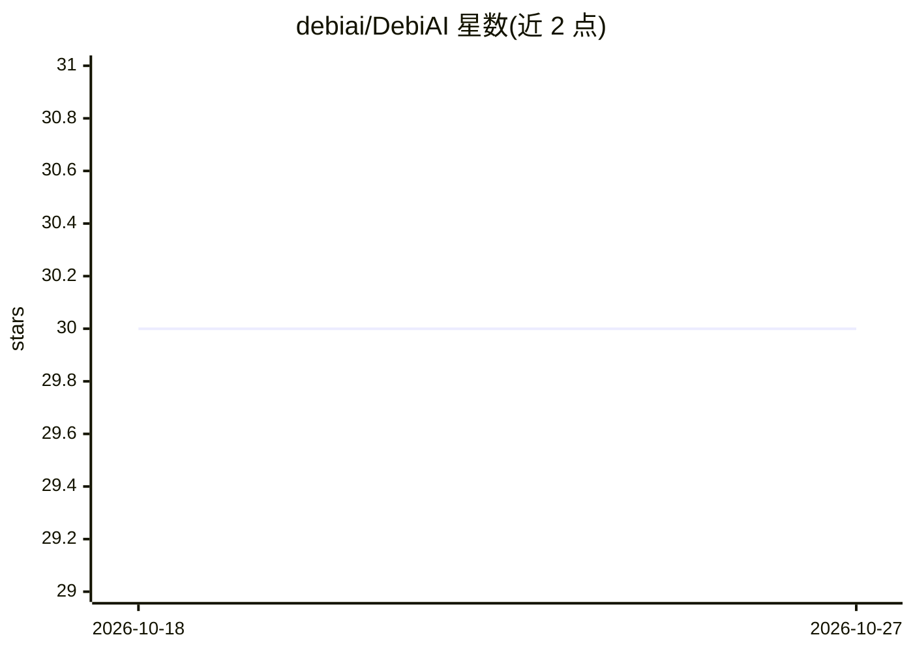

# debiai/DebiAI

⭐ 30 · Vue · Apache-2.0 · 推送 2026-10-15 · [GitHub](https://github.com/debiai/DebiAI) · [官网](https://debiai.irt-systemx.fr) · 组织维护

**面向机器学习项目的数据与模型结果分析评测工具**

开源 Web 应用，用于机器学习模型开发阶段的数据分析与模型性能对比：识别输入、结果、上下文或真值数据中的偏差与错误，按上下文结果比较模型性能，图形化选择与创建数据集用于再训练，并生成可分享的统计可视化。数据可通过 Python 模块从工作流直接导入，或通过 Data Provider Web API 从任意语言与数据源接入而不复制数据。以 pip 包或 Docker 镜像提供，由 IRT SystemX 在 Confiance.ai 计划中开发使用。

## 筛选速览

| 维度 | 判定 | 备注 |
|---|---|---|
| AI 角色 | `ai-ecosystem` | LLM/agent 周边工具 |
| 许可风险 | `permissive` | Apache-2.0 |
| 部署形态 | `None` |  |
| 模型依赖 | — | README 未给出锁定关系 |
| 硬件要求 | — | 无带数字的原话,不猜 |
| 安装摩擦 | `low` | 无编译、无系统依赖或容器化 |
| 成熟度 | — | 结构信号不足 |

## 能力要点

- 识别输入、结果、上下文或真值数据中的偏差与错误
- 可定制的数据可视化仪表盘（基于 Plotly 的统计分析工具）
- Python 模块与 Data Provider Web API 两种数据导入方式
- ICAS 2024 论文获 Best paper award

## 适用场景

- 分析机器学习项目的数据集是否存在偏差或标注错误
- 对比多个模型在不同上下文下的性能
- 图形化筛选数据子集用于进一步分析或再训练
- 为团队或客户生成统计可视化报告

## 场景标签

`模型评测` `数据分析` · 领域:效率与自动化

## 证据(README 行号)

> L15: DebiAI is an open-source web application that aims to facilitate the process of developing Machine Learning models,
> L19: - Identify biases and errors in your input, results, contextual or ground truth project data
> L20: - Make a comparison of the performance of your ML according to their contextual results

## 星数曲线

2026-10-18 30 → 2026-10-27 30（+0）

---
*卡片 v1 · prompt 1.4 · 生成 2026-10-26 · 置信度 high · 依据 README sha `e02edb964671` · [字段定义](../../DATASET.md)*
