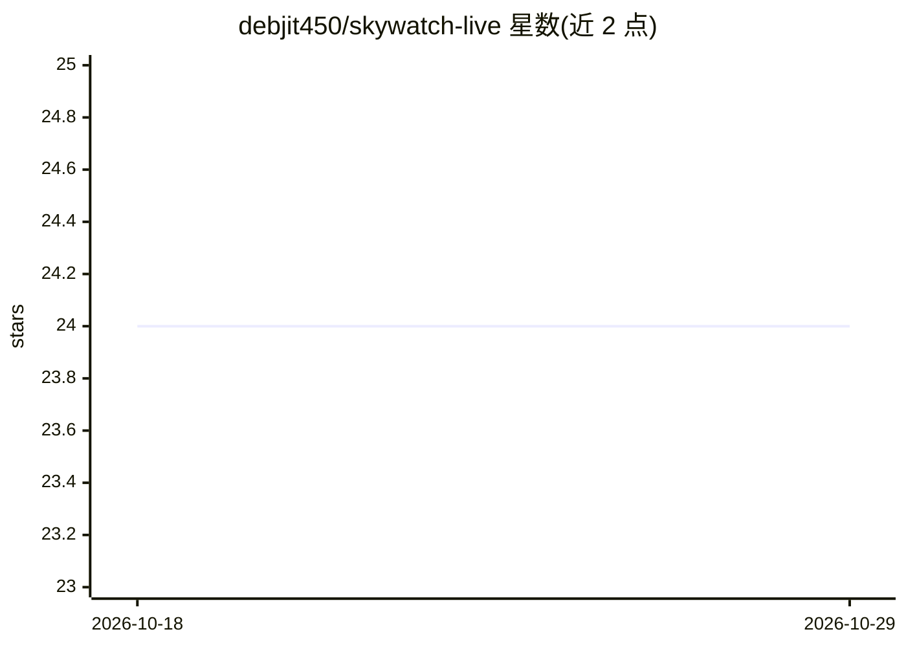

# debjit450/skywatch-live

⭐ 24 · TypeScript · MIT · 推送 2026-08-09 · [GitHub](https://github.com/debjit450/skywatch-live) · [官网](https://github.com/debjit450/skywatch-live) · 个人维护

**实时空域监视与飞行异常检测的全栈 Web 应用**

面向航空数据监控的完整系统：React/TanStack Start 前端配 Django/Channels/Celery 后端，从 OpenSky、ADS-B One、Airplanes.live、OGN/FLARM、卫星 ADS-B 等公共数据源聚合实时飞行状态，结合 SGP4 进行卫星轨道传播可视化，叠加 FAA/AWC 空域限制图层。异常检测部分包含规则告警、集成 ML 评分与可选 LSTM 序列模型（TensorFlow 不在默认依赖中）。支持前端轻量模式与带 PostgreSQL/Redis/Celery 的全栈模式，通过 npm 脚本与 Docker Compose 启动。限制：公共数据源覆盖可能稀疏、被限流，系统无法保证连续覆盖。

## 筛选速览

| 维度 | 判定 | 备注 |
|---|---|---|
| AI 角色 | `ai-enhanced` | 去掉 AI 部分产品仍成立 |
| 许可风险 | `permissive` | MIT |
| 部署形态 | `self-host` | docker 或自建部署 |
| 模型依赖 | — | README 未给出锁定关系 |
| 硬件要求 | — | 无带数字的原话,不猜 |
| 安装摩擦 | `low` | 无编译、无系统依赖或容器化 |
| 成熟度 | — | 结构信号不足 |

## 能力要点

- 聚合 OpenSky、ADS-B One、Airplanes.live、OGN/FLARM 等多源实时 ADS-B 数据
- 规则告警、集成 ML 评分与可选 LSTM 序列异常检测
- CelesTrak TLE + SGP4 卫星轨道传播与可视化
- WebSocket 实时广播、Prometheus 指标、Jaeger 追踪、Grafana 看板

## 适用场景

- 在地图上实时监视空域内飞行动态与历史航迹回放
- 检测飞行异常行为并配置告警规则
- 查看卫星轨道位置与空域限制（SIGMET/TFR）叠加层

## 场景标签

 · 领域:航空/空域监控

## 证据(README 行号)

> L3: Airspace surveillance, satellite situational awareness, and anomaly detection for live public aviation data.
> L5: SkyWatch Live combines a React/TanStack Start frontend with a Django/Channels/Celery backend. It can run as a lightw
> L47: - Client-side and backend anomaly display covering rule-based alerts, ML scores, proximity/circling/behavioral sign

## 星数曲线

2026-10-18 24 → 2026-10-29 24（+0）

---
*卡片 v1 · prompt 1.4 · 生成 2026-10-27 · 置信度 high · 依据 README sha `15b13fcf8734` · [字段定义](../../DATASET.md)*
